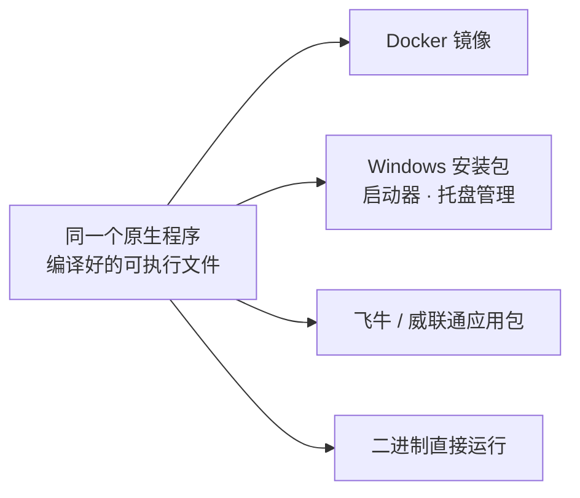

## 先说一个让人安心的事实

经常有新朋友在群里问：「Windows 安装包和 Docker 版功能一样吗？」「飞牛商店里的版本是不是阉割版？」

答案很简单：**它们里面跑的都是同一个程序**。功能没有多一个少一个，只是「外面包的壳」不一样。

这篇文章把 AMMDS 这两年在「怎么把程序交到你手上」这件事上的演变讲一遍。看完你就明白，为什么文档总说「部署核心就是安装包和 Docker」。

{/* truncate */}

## 起点：把程序变「轻」

早期版本的 AMMDS 跑在 Java 虚拟机上，用户要先装 Java 环境、再运行一个 JAR 包，部署门槛不低。

后来我们改用了 GraalVM 原生打包：程序在发布前就提前编译成一个独立的可执行文件。对用户的直接好处是——

- **不用装 Java**：拿到就能跑；
- **没有 JAR 包**：不用理解「运行时」「依赖」这些概念；
- **启动更快**：没有虚拟机预热的过程。

从此，AMMDS 对外交付的最小单位就是这个「二进制程序」。后面所有的部署形态，都是围绕它做的封装。

## 第一种穿法：Docker 镜像

服务器和 NAS 用户的第一选择。作者把编译好的程序连同运行环境一起封进镜像，装了 Docker 的机器一条命令就能跑起来：

```bash
docker run -d --name AMMDS -p 8080:80 \
  -v /opt/ammds/data:/ammds/data \
  -v /opt/ammds/db:/ammds/db \
  qyg2297248353/ammds:latest
```

Docker 的好处是升级省心：拉新镜像、重建容器，数据留在挂载目录里不动。缺点是你得先懂一点点 Docker——至少知道什么是容器、什么是挂载。

## 第二种穿法：Windows 安装包（启动器）

2026 年 4 月，AMMDS Launcher 发布。它解决的是另一类人的问题：**我就是一台 Windows 电脑，不想学命令行**。

启动器做的事说白了就是「当小管家」：把 AMMDS 主程序包起来替你管着——

- 双击安装包，一路下一步装好；
- 程序缩在右下角**系统托盘**里，点图标就能启动、停止、打开管理面板、看日志；
- 支持开机自启，开机后静默运行，不占你的桌面。

用户不需要知道「二进制」「进程」这些词，把 AMMDS 当普通软件用就行。

## 第三种穿法：NAS 应用包

飞牛 FnOS 和威联通 QNAP 的应用中心里，也能装 AMMDS。这两个应用包本质上是把同一个二进制**再包一层**，交给 NAS 的应用中心来安装、启停和升级。

对 NAS 用户来说，体验和装其它 NAS 应用一样：应用中心点一下，向导里填个密码和端口，装完就能用。不用碰 Docker 命令。

## 第四种穿法：直接跑二进制

什么都不包，从发布页下载对应系统的可执行文件，进目录运行。适合想自己管进程的玩家：写个系统服务、配个进程守护，随你安排。

## 它们的关系，一张图看懂



所以回到开头的问题：**部署核心就两条路——能装安装包就装安装包，有 Docker 就用 Docker**，其余形式都是这两条的变体。

## 配套的文档也理顺了

趁着 v2.0.0 文档改版，我们把部署这一块重新组织了一下：

- [先选一种安装方式](/docs/getting-started/overview)：三种安装形式的对比和选择建议，配了链路图；
- [用 Windows 安装包（启动器）](/docs/getting-started/launcher)：新增页面，托盘管理、开机自启、数据目录一次讲清；
- [想改端口、上传大小？看这张表](/docs/getting-started/settings)：全部环境变量逐条说明，配了「生效机制」示意图。

环境变量那一页值得单独一提：很多人改了配置没生效，最后发现是名字写错了一个字母，或者忘了重启。文档里现在把「启动时才读、名字写错等于没设置、改完必须重启」这三条规则画成了图，建议部署前扫一眼。

## 结语

部署形态的变化，方向始终是一个：**让你少学一点无关的东西**。你不需要懂 Java、不需要懂容器原理、也不需要懂进程管理——选一种顺手的穿法，把时间花在整理影片上。

有任何部署上的问题，欢迎到 [GitHub Issues](https://github.com/QYG2297248353/AMMDS-Docker/issues/new) 或社区群组反馈。
