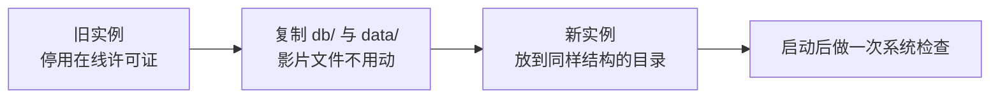

# 备份与恢复

这一页管两件不同的事：**资料搬家**（把整理好的条目导出来，在别处恢复）和**配置异地保存**。它只处理文字和图片这类资料，不包含系统配置和插件钥匙。

> **元数据**：描述条目的信息，比如标题、演员、简介、封面、章节。备份包里装的是这些，不包含影片文件本身。

> **条目**：一条资料记录，比如一部影片、一位演员、一本漫画、一本小说。

## 一、导出资料

进入 **系统管理 → 备份与恢复 → 数据导出**。页面上有四类数据卡片，每类各自决定是否把图片一起打包：

| 类型 | 导出什么 | 勾选「同时导出图像文件」后还会打包 |
| --- | --- | --- |
| 影视 | 影片资料、文件信息、关联的演员、系列、磁力、字幕 | 海报、背景、缩略图、剧照和高清图 |
| 演员 | 演员资料（身材、标签、社交账号等） | 大头照和海报 |
| 漫画 | 相册资料、章节、章节页记录 | 封面、封底和全部章节页图片 |
| 小说 | 小说资料和章节正文 | 封面和封底 |

导出在后台跑，点完就可以离开页面，回头在「导出记录」里下载。记录里能看到类型、文件名、状态（导出中 / 已完成 / 失败）、大小和创建时间，可以下载也可以删除。同一类型正在导出时按钮保持加载状态，不会重复导出。

:::tip[图片只收本机的]
只有保存在本机数据目录里、文件确实存在的图片才会进包；来自外链的图片一律不进包。搬完家如果还留着原来的数据目录，旧路径可以直接用；外链则要看原站点还访不访得到。
:::

## 二、备份包里有什么

标准备份包是一个压缩包，根目录必须有 `manifest.json` 和 `data.json`，图片目录可选：

| 文件 | 作用 |
| --- | --- |
| `manifest.json` | 包的清单：格式标识、版本、类型、条目数、图片清单 |
| `data.json` | 资料本体，一个条目一条 |
| `images/` | 勾了导出图片时才有，按条目分目录放图片 |

一个包只能装一种类型。清单里的条目数必须和 `data.json` 里的实际条数一致，否则导入会被拒绝。

## 三、恢复资料

1. 进入 **数据导入**，把压缩包或者单个 `data.json` 拖进上传区。
2. 选导入方案（见下表）。
3. 点「解析预览」，看条目数、图片数、包大小和包内文件数。
4. 校验通过后点「开始导入」，完成后显示成功、跳过、更新、失败各多少条。

解析阶段会先做检查：缺清单文件、条目路径不合法、格式标识不对、版本不支持、类型不在允许范围、条目数和清单对不上、图片路径不对或文件不存在，任一项不满足就**禁止导入**，并且不会改动任何数据。

单条失败不会中断整包导入，失败原因会记下来，详情里最多展示前 50 条。

### 设置项说明：三种导入方案

| 方案 | 行为 | 什么时候用 |
| --- | --- | --- |
| 跳过已存在 | 撞上已有的就跳过，不写入也不更新 | 只想补齐缺的，怕改坏已有资料 |
| 覆盖更新 | 撞上就覆盖；漫画、小说、剧集会删掉重建章节 | 想把现有资料换成备份包里的版本 |
| 合并更新 | 只补缺失的字段，列表去重合并，不删已有数据 | 想把两边资料拼起来 |

怎么算「同一条」：影视看番号有没有交集（合并方案下再按标题比对），演员看姓名是否完全一致，漫画优先看书号其次看名称，小说看书名或书号，剧集按外部站点 ID 依次匹配。

## 四、用分享链接导入

在 **分享导入** 标签页：

| 设置项 | 管什么 / 怎么填 | 不填会怎样 |
| --- | --- | --- |
| 分享链接或短码 | 对方给你的公开地址，或地址最后那段短码 | 没有内容可预览 |
| 访问密码 | 对方设了密码才需要填 | 提示需要密码，导入不了 |
| 导入方案 | 跳过已存在 / 覆盖更新 / 合并更新 | 默认「跳过已存在」 |

填好点「预览分享」，确认类型、标题和条目数后点「导入分享」。如果对方没开放导入权限，页面会提示「该分享不允许导入」，可以填理由提交申请（提交前要把用户 ID、昵称、邮箱补全）。

下方的「链接记录」显示导入结果：成功、无权限导入、链接无效、已过期、失败；「申请记录」显示申请理由和状态，待处理的可以取消。删记录不影响已经导入的数据。

## 五、配置单独存一份云端

上面的备份包**不包含系统配置、插件钥匙和订阅规则**。想在异地留一份配置，用「集成应用 → 云端同步」里的网盘或对象存储服务：

- 它只备份「配置类」数据，不含图片和影片条目，所以包很小。
- 备份包是加密的，**口令丢了就恢复不了**，请和备份文件分开保管。
- 恢复时可以选合并更新、本地优先或远端优先。
- 网盘服务和对象存储服务本身连接配置不参与恢复，避免恢复完连不上远端。
- 网盘只负责配置备份；要往远端放图片这类资源，用对象存储服务（云上专门存文件的柜子），两者互相独立。

> **口令**：自己设的一串文字，用来加密和解密备份包。系统不会替你保存，忘了就只能重新做备份。

## 建议的备份习惯

1. 资料按类型分别导出，需要图片时再勾选「同时导出图像文件」。
2. 配置单独用云端备份，加密口令和备份文件分开保管。
3. 恢复前先在版本相同的另一套 AMMDS 上用「解析预览」，确认校验通过再导入。
4. 大版本升级前做一次完整导出，升级后做一次系统检查。

## 把数据搬到新机器（换部署方式同理）

除了导出备份包，还有一个更省事的搬法：直接复制目录。适合换机器、从 Docker 换安装包、从安装包换 Docker 这类「整套搬家」的场景。

四步走：

1. **停掉旧实例**，最好先在「用户中心 → 许可证」里停用在线许可证，换到新机器再激活，免得占用名额。
2. **复制两块目录**：`db/`（数据库）和 `data/`（图片、缓存、密钥、日志）。`data/secret/` 里的恢复密钥务必一起带走。影片文件不用复制，路径不变的话直接沿用。
3. **新实例用同样的目录结构启动**。Docker 就是把挂载路径指到搬过去的目录；安装包就是把数据目录指过去。
4. **启动后跑一次系统检查**，确认磁盘、依赖程序、许可证状态都正常。

:::note[两种搬法怎么选]
数据量大、想原样保留所有细节，用目录复制；只想带走影片资料和配置、想顺便清理缓存，用备份包导出导入。两者可以叠加：先复制目录，再导出一份备份包留底。
:::

## 出问题了怎么办

- **导入被拒绝**：多半是包不完整或条目数和清单对不上。重新导出一次，别手工改包里的文件。
- **导入后资料没变**：检查是不是选了「跳过已存在」；要覆盖就换「覆盖更新」。
- **图片恢复不出来**：包里没带图片（导出时没勾），或图片是外链。重新导出时勾上图片。
- **导出记录里状态是失败**：去任务日志看失败原因，常见是磁盘空间不够。
- **云端配置恢复不了**：先确认口令正确、远端文件没损坏；连接参数本身不会被恢复，需要手动填。
- **想确认恢复后有没有问题**：做一次[系统检查、日志、存储、许可证与用户](./maintenance.md)里的全量扫描。
