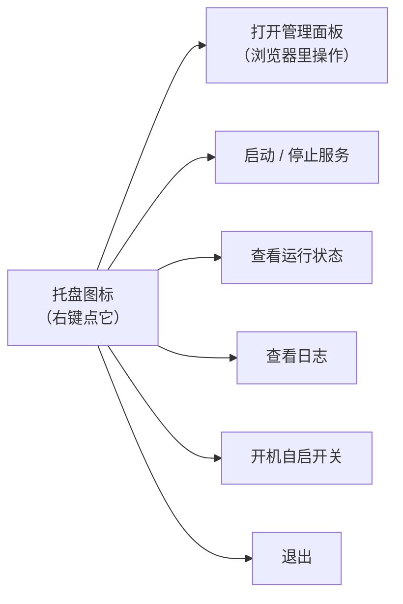

# 用 Windows 安装包（启动器）

不想敲命令、也不想装 Docker，就用 Windows 安装包。双击安装后，AMMDS 会像普通软件一样待在你的电脑里：**缩在右下角的系统托盘里**，点图标就能启动、停止、打开管理页面。

安装包的本质是：一个「启动器」程序把 AMMDS 主程序包起来替你管着。你在浏览器里用到的功能，和 Docker、二进制方式跑起来的完全一样。

> **启动器**：负责替你运行 AMMDS 主程序的小管家。你点托盘图标下指令，它去启动或停止真正干活的程序，并把运行状态展示给你。

## 环境要求

| 项目 | 要求 |
| --- | --- |
| 系统 | Windows 10（1903 及以上）或 Windows 11，64 位 |
| 运行环境 | 不用装 Java，也不用装 Docker，安装包自带 |
| 权限 | 安装过程需要管理员权限（要往安装目录写文件、登记开机自启）；日常使用普通权限即可 |
| 网络 | 自动补资料、找资源需要能访问外网 |

## 下载

到官方发布页下载最新的 `.exe` 安装包：https://github.com/QYG2297248353/AMMDS-Launcher/releases

只从官方发布页下载。第三方改包可能夹带别的程序，或者数据目录结构和当前版本对不上。

## 安装

1. 双击安装包，允许管理员权限请求。
2. 按向导选安装位置，其余保持默认即可。
3. 勾选「开机自启动」的话，电脑开机后 AMMDS 会静默启动，不用你手动点。
4. 安装完成后，右下角托盘区会出现 AMMDS 图标；双击或在图标上右键即可开始使用。

## 托盘管理

安装完成后，日常操作都在托盘图标上：

| 托盘操作 | 干什么用 |
| --- | --- |
| 打开管理面板 | 在默认浏览器里打开 AMMDS 管理页面，平时整理影片都在这里 |
| 启动 / 停止 | 让后台服务跑起来或停下来；停止后浏览器里就打不开页面了 |
| 查看状态 | 快速看一眼服务是否在运行、占用多少资源 |
| 查看日志 | 直接打开运行日志，排查问题时用 |
| 退出 | 彻底退出 AMMDS，后台服务一并停止 |

:::tip[关掉浏览器窗口 ≠ 退出程序]
在浏览器里点右上角的 × 只是关掉了页面，AMMDS 还在托盘里继续跑（扫描、刮削等任务会照常执行）。想真正停下来，要从托盘图标退出，或者点「停止服务」。
:::

## 数据放在哪

和其它方式一样，AMMDS 把影片资料、图片、日志、数据库都存在你自己的硬盘上：

| 位置 | 里面是什么 |
| --- | --- |
| 安装时选的数据目录 | `data/`（图片、缓存、字幕、日志、恢复密钥、依赖程序）和 `db/`（数据库），程序会自动建好 |
| 你的影片目录 | 要扫描和整理的影片文件，放在哪里都行，之后在管理面板里把路径填给程序 |
| 默认数据目录 | 安装时一路「下一步」的话，数据会落在当前用户的应用数据目录下 |

:::warning[两件事别忘]
1. **别把影片放进数据目录**。影片单独放一个目录，免得清理数据时误删影片。
2. **备份就备这两样**：`db/` 和 `data/`。重装系统前把它们复制走，装回来再放回原处，资料就都在。
:::

## 想改端口、上传大小

启动器里跑的仍是同一个 AMMDS 程序，所以[环境变量](./settings.md)里的启动设置项同样适用，在启动器提供的设置界面里填写即可；具体入口以你手上版本的启动器界面为准。改完从托盘重启服务才会生效。

## 升级

新版本发布后，直接用新版安装包覆盖安装即可，数据目录不受影响。稳妥起见，覆盖前先备份 `db/` 和 `data/`。

## 卸载

在 Windows 的「设置 → 应用 → 安装的应用」里找到 AMMDS 点卸载。卸载只移除程序本身；`data/` 和 `db/` 里的数据会保留，确认不再需要时再手动删除。

## 出问题了怎么办

| 现象 | 可能原因 | 处理 |
| --- | --- | --- |
| 安装时提示权限不足 | 没有允许管理员权限 | 右键安装包，选「以管理员身份运行」 |
| 托盘图标不见了 | 程序被退出，或图标被 Windows 折叠隐藏 | 点任务栏的「^」展开隐藏图标；实在没有就从开始菜单重新打开 |
| 点「打开管理面板」没反应 | 服务还没启动，或端口被占用 | 先从托盘确认服务在运行；端口冲突时改一个访问端口再启动 |
| 开机没有自动启动 | 安装时没勾自启，或后来被安全软件拦了 | 在托盘菜单或安装目录的设置里重新打开自启；检查安全软件的拦截记录 |
| 浏览器能打开但页面怪怪的 | 页面缓存旧了 | 强制刷新一次（`Ctrl` + `F5`） |
| 其它现象 | — | 到[常见问题](../faq.md)按现象找 |

## 接着看

- [环境变量](./settings.md)
- [初始化向导：第一次配置](./install-wizard.md)
- [第一次打开：登录和基本设置](./first-login.md)
