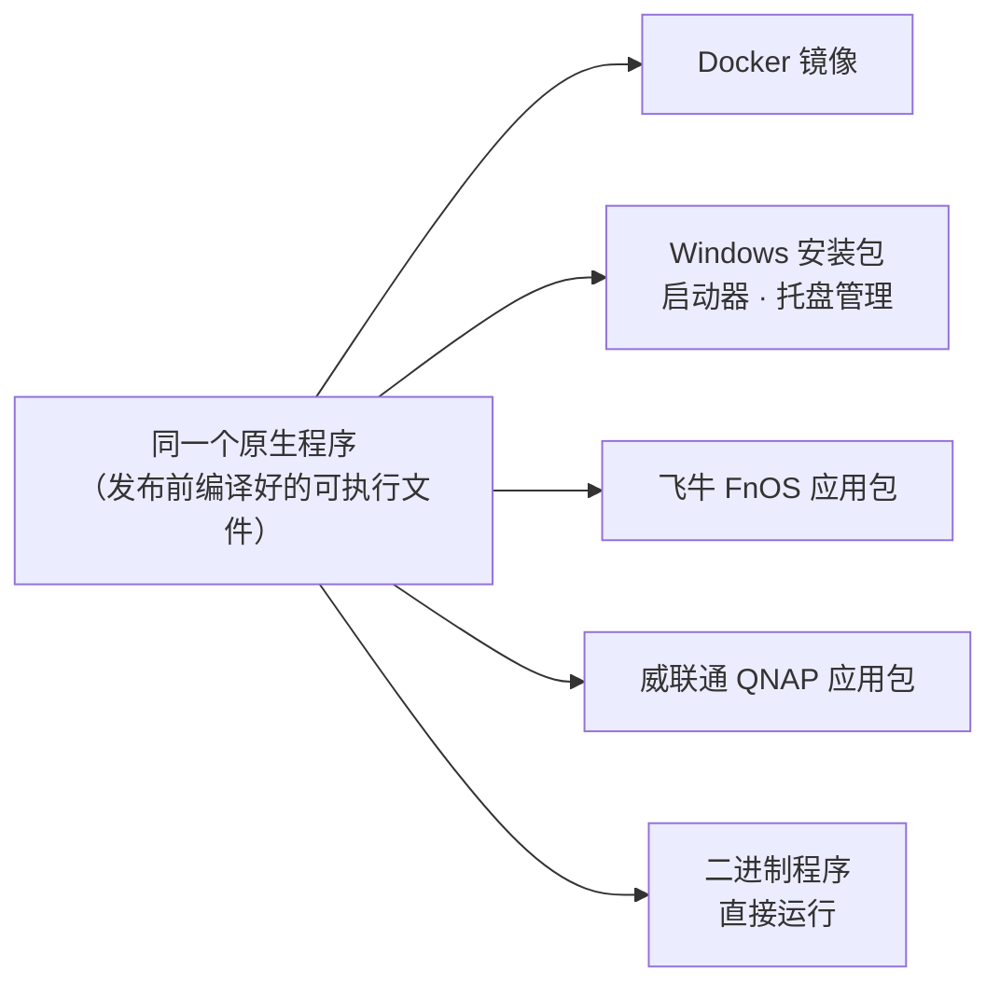

# 先选一种安装方式

AMMDS 官方发给用户的安装形式一共**三种**，里面跑的是同一个程序：

1. **Docker 镜像** —— 一个已经配好运行环境的容器包。
2. **Windows 安装包** —— 双击安装，由启动器负责启动、停止和托盘管理。
3. **二进制程序** —— 一个可以直接运行的可执行文件。

三种都是用 GraalVM Native Image 技术打包的：程序在发布前就编译成了一个独立的可执行文件，运行时**不需要装 Java，也没有 JAR / WAR 这类文件**。你下载到的是一个程序文件、一个安装包，或者装着这个文件的 Docker 镜像，跑起来就行。

> **GraalVM Native Image**：一种打包技术。它把程序提前编译成一个独立的可执行文件，用户拿到后不用再装运行环境，双击或在命令行里执行就能启动。你不需要懂它的原理，只要记住两件事：**不用装 Java**、**没有 JAR 包**。

> **二进制程序**：也叫可执行文件。Windows 上通常是 `.exe` 结尾的文件，Linux 上是一个没有扩展名的文件。AMMDS 发行包里的这个程序叫 `ammds`（Windows 下为 `ammds.exe`），具体名字以你下载到的发行包为准。

所以不用再找「该装哪个版本的 Java」「JAR 包放哪里」这类教程了 —— 那是自己编译源码时才做的事，不是安装 AMMDS 要做的事。

## 你下载到的其实都是同一个程序

AMMDS 官方发布的所有安装形式，底层都是上面说的那个二进制程序，只是「外面包的壳」不一样：

- **Docker 镜像**：作者把编译好的程序连同运行环境一起封进镜像，装了 Docker 的机器一条命令就能跑。
- **Windows 安装包**：启动器程序把二进制包起来，装完缩在 Windows 右下角的托盘里，点图标就能启动、停止、打开管理页面，见[用 Windows 安装包（启动器）](./launcher.md)。
- **飞牛、威联通应用包**：本质上是把二进制再包一层，交给 NAS 的应用中心来装和管，见[在 NAS 上安装](./nas.md)。
- **二进制程序**：什么都不包，下载下来直接运行，见[在 Windows / Linux 上直接运行](./native.md)。

所以对普通用户来说，部署核心就两条路：**能装安装包就装安装包，有 Docker 就用 Docker**，其余形式都是这两条的变体。装哪种，里面跑的都是同一个程序，功能没有区别，数据目录的含义也一样。

如果你还没决定，先回答一个问题：**你的设备上有没有 Docker？** 有就选 Docker；没有就下载安装包或二进制程序。

## 开始之前的几个前提

| 项目 | 说明 |
| --- | --- |
| 系统 | 需要 64 位系统。系统检查会把 32 位系统标成告警，并提示 FFmpeg 等依赖程序（程序自己要用的辅助软件）可能无法使用 |
| 运行环境 | 三种形式都不用你另外装 Java 或别的运行环境，程序已经自带 |
| 二进制程序要选对系统 | 可执行文件是按系统分别编译的，Windows 和 Linux 各有一份，下载时看清自己用的系统 |
| 网络 | 自动补资料、找资源、推送消息都需要能访问外网。纯内网环境只能用已有的本地资料 |

> **Docker**：一种把软件连同它需要的环境打包在一起的运行方式。装好 Docker 之后拉一个包就能跑，不用自己一件件装依赖。

> **镜像**：软件的打包文件，相当于「安装盘」。名字写成 `qyg2297248353/ammds:latest` 这样，冒号后面是版本标签。

> **容器**：镜像跑起来之后的那一份运行实例。

## 几种方式对比

| 方式 | 是怎么跑的 | 适合谁 | 以后怎么升级 |
| --- | --- | --- | --- |
| Docker 镜像 | 一个容器里同时跑网页和后台，对外只用映射一个端口 | 已经装了 Docker 的 Linux 服务器和 NAS | 拉新镜像后重建容器，数据留在挂载目录里 |
| 安装包 | 双击安装，之后缩在系统托盘里，点图标启动和停止 | Windows 用户，想像装普通软件一样装 | 用新版安装包覆盖安装，数据目录不受影响 |
| 二进制程序 | 直接运行一个可执行文件，网页和后台都在这一个程序里 | 没有 Docker 的 Windows / Linux 主机，或者想自己管一个进程 | 换成新版本的可执行文件后重启 |

### 怎么选

| 你的情况 | 建议 |
| --- | --- |
| 用的就是 Windows，想双击装好、开机自启、托盘管理 | Windows 安装包，见[用 Windows 安装包（启动器）](./launcher.md) |
| 服务器已经装了 Docker，或者希望端口、目录、开机自启都统一管理 | Docker，见[用 Docker 安装](./docker.md) |
| 设备是飞牛 FnOS、威联通 QNAP，习惯在应用中心里管理软件 | 用 NAS 应用包，见[在 NAS 上安装](./nas.md) |
| Windows / Linux 主机没有 Docker，想直接跑一个程序 | 二进制程序，见[在 Windows / Linux 上直接运行](./native.md) |
| 想用系统服务托管、开机自启一个单独的程序 | 二进制程序，见[在 Windows / Linux 上直接运行](./native.md) |

:::note[NAS 应用包不算第四种]
飞牛 FnOS、威联通 QNAP 的「应用包」只是这些设备帮你把程序装好、管起来的一个入口，里面仍然是上面说的同一个程序。它不占一个独立的名额，只是省掉了手动敲命令的步骤。
:::

## 端口：装好之后用哪个地址打开

| 方式 | 浏览器里用的端口 | 说明 |
| --- | --- | --- |
| Docker | 容器里是 `80`，主机端口由你自己映射 | 例如映射成 `8080:80`，就用 `http://主机IP:8080` 访问 |
| 二进制程序 | `8080` | 可以用「访问端口」这个设置项改 |
| Windows 安装包 | 由启动器管理，在启动器界面里查看或修改 | 装好后点托盘图标就能看到访问地址 |
| NAS 应用包 | 安装时自己填的那个 | 装完后用 `http://NAS_IP:端口` 访问 |

Docker 镜像内部还有一个 `8080` 端口，是给后台用的，只在容器内部转接，不需要映射到主机上。

:::note[想让手机或客户端自动找到服务]
桌面客户端可以在同一个局域网里自动发现 AMMDS，靠的是两个 UDP 端口（`47823` 探测、`47824` 广播）。Docker 只转发 TCP，需要自动发现就得把这两个 UDP 端口单独映射出来；不需要的话，在客户端里手动填服务地址也可以。
:::

## 数据目录：一定要先搞清放哪儿

不管用哪种方式，程序都把**启动时所在的目录**当作根目录，`data/`、`db/` 都建在这下面。所以请先建一个固定目录，在那里启动。

| 目录 | 里面是什么 |
| --- | --- |
| `data/` | 图片、缓存、字幕、日志、恢复密钥，以及自动下载的 FFmpeg 等依赖程序 |
| `db/` | 数据库文件，保存影片、任务、配置等全部业务数据 |
| `download/` | 镜像预留的目录，通常和下载器的保存目录共用，方便下载完直接扫描 |
| `data/logs/` | 运行日志，系统检查和运行日志页面都读这里 |

:::tip[备份优先级]
`db/` 和 `data/` 是必须备份的两块：前者是全部业务数据，后者包含图片和恢复密钥。影片文件按你自己的习惯备份。
:::

## 设置项说明

安装阶段要你决定的就这几项，填之前先看清楚填错了会怎样。

| 设置项 | 它管什么 | 不填会怎样 | 改完要不要重启 |
| --- | --- | --- | --- |
| 访问端口（`AMMDS_SERVER_PORT`） | 浏览器里访问用的端口号 | 不填就用程序自带的默认端口（`8080`） | 要 |
| 媒体目录路径 | 告诉程序去哪个目录里找你的影片文件 | 不填就没有可扫描的内容；路径写错会扫描不到文件，看起来像「文件没了」 | 不用，随时可以改 |
| 数据目录（`data/`、`db/`） | 存放图片、日志、恢复密钥和数据库 | 不单独挂载（Docker 场景）会在删容器时一起丢掉 | 要 |
| 时区（`TZ`） | 日志时间和定时任务按哪个时区算 | 不填用默认时区，任务时间可能对不上你的作息 | 要 |
| 运行用户（`PUID` / `PGID`） | 程序以哪个用户身份读写文件（Docker 场景） | 不填以默认用户运行；与主机目录属主不一致时会出现「写入失败」「无权限」 | 要 |

:::warning[媒体目录别放进程序目录]
使用 Docker 时，请把主机上的媒体目录以**相同的路径**挂进容器（例如 `/mnt/media:/mnt/media`），不要让它落在 `/ammds` 下面，免得和程序数据混在一起，清理时误删。
:::

## 装好之后

1. 用浏览器打开访问地址，用默认管理员账号登录，见[第一次打开：登录和基本设置](./first-login.md)。
2. 想改端口、上传大小这类启动设置，见[环境变量](./settings.md)。
3. 想立刻看到效果，跟着[十分钟整理好第一批影片](./first-library.md)走一遍。

## 出问题了怎么办

- **不知道选哪种**：Windows 用安装包，有 Docker 就用 Docker，其它情况下载二进制程序直接跑；选错了也能换，数据目录备份好就行。
- **二进制程序双击没反应，或提示无法执行**：多半是下载了别的系统的发行包（Windows 和 Linux 不通用）。Linux 上还要先给它执行权限，见[在 Windows / Linux 上直接运行](./native.md)。
- **页面打不开**：先确认访问端口和你映射的端口是不是同一个，再确认防火墙放行了；首次启动还要等依赖程序下载完，看日志有没有持续输出。
- **数据「不见了」**：多半是启动时所在的目录变了，程序在另一个地方新建了 `data/` 和 `db/`。回到你原来的目录重新启动。
- **启动直接退出**：看看日志里有没有 `inotify`（文件监听功能）或 CPU 指令集相关的提示，这两种情况在[常见问题](../faq.md)里都有处理步骤。

## 接着看

- 从 1.x 升级过来的？先看[升级说明](../upgrade.md)
- [用 Docker 安装](./docker.md)
- [用 Windows 安装包（启动器）](./launcher.md)
- [在 Windows / Linux 上直接运行](./native.md)
- [在 NAS 上安装](./nas.md)
