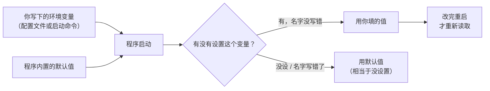

# 环境变量

AMMDS 有一批「启动设置」，用来改端口、上传大小、时区这类**在页面里改不了**的东西。这一页把它们逐条列出来，写明：变量名是什么、默认值多少、管什么、不填会怎样、改完要不要重启。

默认就能用，绝大多数人**一条都不用改**。等真的遇到「端口冲突」「上传大文件失败」「日志看不够细」时，再来这里找对应的一项。如果你要改的是域名、代理、通知开关这类**页面里能改**的设置，请去[系统配置](../backend/system/config.md)，不在本页。

> **环境变量**：启动前写给程序的一组设置。Docker 里写在配置文件的 `environment` 段，直接运行时写在可执行文件的启动命令前面。名字写错等于没设置，程序按默认值跑。

> **端口**：一台机器上区分不同服务的号码，`http://主机IP:8080` 里的 8080 就是端口。

## 怎么改

按你的安装方式对照下表：

| 你的安装方式 | 怎么改 |
| --- | --- |
| Docker / Compose | 写进 `environment` 段，然后**重建**容器（不是只重启） |
| Windows 安装包（启动器） | 在启动器提供的设置界面里填写，然后从托盘重启服务；没有对应输入框时，可在启动器设置里加环境变量 |
| 命令行直接运行 | 写在可执行文件的启动命令前面，例如 `AMMDS_SERVER_PORT=9090 ./ammds`（Windows 为 `ammds.exe`） |
| 系统服务托管 | 在服务配置里加环境变量，然后重启服务 |

:::warning[改完必须重启]
所有启动设置都是**启动时读取**的，改完不重启不会生效。Docker 场景要**重建容器**才生效，单纯 `docker restart` 不会重新读取 `environment` 段。页面里能改的那些设置（系统配置页）一般保存后立即生效，不在此列。
:::

一个完整的 Docker Compose 片段长这样，照着加即可：

```yaml
services:
  ammds:
    image: qyg2297248353/ammds:latest
    ports:
      - "8080:8080"
      - "47823:47823/udp"   # 局域网发现，不用可以不加
      - "47824:47824/udp"
    environment:
      - TZ=Asia/Shanghai
      - PUID=0
      - PGID=0
      - AMMDS_SERVER_PORT=8080
    volumes:
      - ./data:/ammds/data
      - ./db:/ammds/db
      - ./download:/ammds/download
```

## 这些设置是怎么生效的

环境变量不是「填了就完事」，它有一套固定的生效时机，弄清楚能少走很多弯路：



三句话记住它：

1. **启动时读一次**：程序只在启动的那一刻读环境变量，之后你在配置文件里改了也不理会，直到重启。
2. **名字写错等于没设置**：变量名是精确匹配的，少一个下划线、大小写不对，程序都按「没填」处理，用默认值接着跑，不会报错提醒你。
3. **外部服务那组是特例**：`AMMDS_METATUBE_URL`、`AMMDS_QBITTORRENT_URL` 这些「外部服务接入」变量，是**每次启动都重新写入**配置的，会覆盖你在页面上做的修改（详见下文「外部服务接入」一节的提醒）。

另外要分清两套设置：

| | 启动设置（本页讲的） | 系统配置（页面里改的） |
| --- | --- | --- |
| 在哪改 | Docker 配置文件、启动命令、启动器设置 | 登录后台 → 系统配置 |
| 什么时候生效 | 重启后 | 一般保存即生效 |
| 典型内容 | 端口、内存上限、功能开关 | 域名、代理、通知开关、刮削偏好 |
| 变量形式 | `AMMDS_` 开头为主 | 存在数据库里，不是环境变量 |

## 服务与网络

| 变量名 | 默认值 | 它管什么（大白话） | 不填会怎样 | 重启 |
| --- | --- | --- | --- | --- |
| `AMMDS_SERVER_PORT` | `8080` | 浏览器里访问用的端口号 | 用 8080 | 要 |
| `AMMDS_SERVER_HOST` | `0.0.0.0` | 监听地址，默认所有网卡都能连 | 监听所有地址；改成 `127.0.0.1` 后只有本机连得上 | 要 |
| `AMMDS_SERVICE_ADDRESS` | 空 | 对外公布的本机地址，供接口文档等使用 | 登录成功时系统会自动把当前访问地址写进去 | 要 |
| `AMMDS_CONNECTION_TIMEOUT` | `1800000` | 一个连接最多等多久，单位是毫秒（默认 30 分钟） | 用默认值；一般不用改 | 要 |
| `AMMDS_CACHE_PATH` | `./data/cache` | 上传文件时临时存放的地方 | 放在 `data/cache`；所在磁盘满了会导致上传失败 | 要 |
| `AMMDS_MAX_FILE_SIZE` | `20GB` | 一次能传多大的单个文件 | 用默认值；传大文件被拒时再调大 | 要 |
| `AMMDS_MAX_REQUEST_SIZE` | `5GB` | 一次请求（可能含多个文件）总共能多大 | 用默认值；要和上一项一起调，且不能小于上一项 | 要 |
| `AMMDS_DEBUG` | `INFO` | 日志记录到多细；改成 `DEBUG` 会更详细 | 用 `INFO`；排查问题时可临时调细，查完改回来 | 要 |

:::note[上传大小的坑]
Docker 镜像内置的网页转发（nginx）另有自己的大小上限（约 10G）。把上面两项调得更大时，请求可能先被它拦下，需要同步调整；前面还挂了别的反向代理也一样，要一起调。
:::

## 管理员账号

| 变量名 | 默认值 | 它管什么（大白话） | 不填会怎样 | 重启 |
| --- | --- | --- | --- | --- |
| `ADMIN_USER` | 无 | 启动时预先创建管理员用的用户名，必须和 `ADMIN_PASS` 一起填 | 等初始化向导创建；只填其中一项不会建号 | 要，且只对**首次建库**有效 |
| `ADMIN_PASS` | 无 | 预建管理员的初始密码，必须和 `ADMIN_USER` 一起填 | 同上 | 要，同上 |

账号格式有要求：用户名 3–32 位，只能用字母、数字、`_`、`-`；密码 6–22 位，要包含大小写字母和数字或特殊字符。数据库里已经有管理员之后，再改这两个变量**不会生效**——改密码请到个人中心。批量部署想省掉初始化向导时，才用这一组。

## 功能开关

| 变量名 | 默认值 | 它管什么（大白话） | 不填会怎样 | 重启 |
| --- | --- | --- | --- | --- |
| `AMMDS_SCHEDULER_ENABLE` | `true` | 到点自动跑的任务还跑不跑 | 默认开启；关掉后连手动执行定时任务也会被拒绝 | 要 |
| `AMMDS_MONITOR_ENABLE` | `true` | 目录监控：文件一有变动就自动扫描 | 默认开启；关掉后只能靠定时扫描 | 要 |
| `AMMDS_SYSTEM_MODE` | 空（完整模式） | 跑完整模式 / 纯后台 / 只接口 | 空为完整模式；只认 `full`、`backend`、`api` 三个值，其他值会被忽略 | 要 |
| `AMMDS_NETWORK_TIMEOUT` | `60` | 访问外部网站最多等多少秒 | 一分钟；网络很差时可以调大 | 要 |
| `AMMDS_SCRAPE_LIMIT` | `60` | 一次批量刮削最多处理多少条 | 默认值；条目多时会分批，多跑几次即可 | 要 |
| `AMMDS_DISK_THRESHOLD` | `10737418240` | 磁盘剩余空间低于多少就告警，单位是字节（默认约 10 GB） | 用默认值；想晚点收到告警就调小 | 要 |
| `AMMDS_DISK_RATIO` | `0.1` | 磁盘剩余占比低于多少就告警（默认 10%） | 用默认值；和上一项同时生效 | 要 |

:::tip[三种运行模式怎么选]
- `full`（默认）：前台站点和后台管理都能用。
- `backend`：只留后台管理，前台站点不开放。
- `api`：只对外提供接口，不开放网页界面。

这一项在系统配置页里也有，但用环境变量改**需要重启**，而且每次启动都会以环境变量的值为准。
:::

## 局域网自动发现

桌面客户端靠这一组设置在同一局域网里自动找到 AMMDS。

| 变量名 | 默认值 | 它管什么（大白话） | 不填会怎样 | 重启 |
| --- | --- | --- | --- | --- |
| `AMMDS_DISCOVERY_ENABLED` | `true` | 要不要开启自动发现 | 默认开启；关掉后只能在客户端手动填地址 | 要 |
| `AMMDS_DISCOVERY_PORT` | `47823` | 客户端找服务时用的 UDP 端口 | 47823；改了就要同步放行和映射 | 要 |
| `AMMDS_DISCOVERY_ANNOUNCE_ENABLED` | `true` | 要不要主动广播自己的存在 | 默认开启 | 要 |
| `AMMDS_DISCOVERY_ANNOUNCE_PORT` | `47824` | 广播用的 UDP 端口 | 47824 | 要 |
| `AMMDS_DISCOVERY_ANNOUNCE_INTERVAL_SECONDS` | `15` | 隔多少秒广播一次 | 15 秒；填 0 或负数会回落到 15 秒 | 要 |
| `AMMDS_DISCOVERY_ANNOUNCE_TARGETS` | 空 | 广播发给谁，多个目标用逗号分隔 | 留空表示自动使用广播地址和各网卡地址；填错了客户端收不到 | 要 |

:::note[Docker 用户注意]
容器里的网页转发只管 TCP。要用自动发现，必须把 `47823` 和 `47824` 这两个 UDP 端口单独映射出来，否则客户端发现不到服务，见上面的 Compose 示例。
:::

## 网络代理

程序访问外部网站（资料站、刮削源、通知服务）时，可以走系统级代理。这一组是操作系统通用的代理变量，大小写两种写法都支持（例如 `HTTP_PROXY` 和 `http_proxy`）。

| 变量名 | 默认值 | 它管什么（大白话） | 不填会怎样 | 重启 |
| --- | --- | --- | --- | --- |
| `HTTP_PROXY` / `http_proxy` | 无 | HTTP 请求走哪个代理 | 直连；有 `ALL_PROXY` 时退回它 | 要 |
| `HTTPS_PROXY` / `https_proxy` | 无 | HTTPS 请求走哪个代理 | 同上 | 要 |
| `ALL_PROXY` / `all_proxy` | 无 | 通用代理，HTTP、HTTPS 都没单独设置时用 | 直连 | 要 |
| `NO_PROXY` / `no_proxy` | 无 | 哪些地址不走代理，支持 `*`、`*.域名`、IP、IP 段和 `主机:端口` | 所有请求都按代理规则走 | 要 |

:::note[和页面里的代理设置是什么关系]
系统配置 → 网络配置里也有一套代理设置，那套存在数据库里、保存后立即生效。两套是并存的，优先级为：**页面里的设置 > 环境变量 > 直连**。日常用页面那套即可；只有需要在启动前就生效（比如容器里统一注入）时才用这里的环境变量。
:::

## 外部服务接入

下面这些填了内容，程序每次启动时会把它写进对应的服务配置并打开开关。适合批量部署；只配一两个服务时，直接在页面里填并做连通性测试更直观。

| 变量名 | 默认值 | 它管什么（大白话） | 不填会怎样 | 重启 |
| --- | --- | --- | --- | --- |
| `AMMDS_METATUBE_URL` / `AMMDS_METATUBE_TOKEN` | 无 | 影片资料服务 MetaTube 的地址和授权码 | 不自动启用；填错会连不上、补不到资料 | 要 |
| `AMMDS_PROWLARR_URL` / `AMMDS_PROWLARR_TOKEN` | 无 | 资源检索服务 Prowlarr 的地址和密钥 | 同上 | 要 |
| `AMMDS_IYUU_TOKEN` | 无 | 辅种服务 IYUU 的授权码 | 不自动启用 | 要 |
| `AMMDS_QBITTORRENT_URL` / `AMMDS_QBITTORRENT_USERNAME` / `AMMDS_QBITTORRENT_PASSWORD` | 无 | 下载器 qBittorrent 的地址和登录账号 | 不自动启用；填错会导致推送过去没反应 | 要 |
| `AMMDS_TELEGRAM_BOT_TOKEN` / `AMMDS_TELEGRAM_CHAT_ID` | 无 | 推送到 Telegram 的机器人凭证和会话 ID | 不自动启用；填错收不到消息 | 要 |

:::tip[它们会覆盖页面上的改动]
这一组设置是**每次启动都重新写入**的。也就是说，你在页面里改了同一个服务的配置，重启后会被这里的值覆盖。不想被覆盖就把这些变量删掉。
:::

## 容器专用

只有 Docker 部署会用到。

| 变量名 | 默认值 | 它管什么（大白话） | 不填会怎样 | 重启 |
| --- | --- | --- | --- | --- |
| `TZ` | `Asia/Shanghai` | 容器时区，影响日志时间和定时任务 | 用上海时区；任务时间可能对不上你的作息 | 要（重建容器） |
| `PUID` / `PGID` | `0` | 程序以哪个用户 / 组身份读写文件 | 以 root 运行；和主机目录属主不一致会出现「写入失败」「无权限」 | 要（重建容器） |
| `UMASK` | `022` | 新建文件的默认权限掩码 | 用 022；一般不用改 | 要（重建容器） |
| `NGINX_PORT` | `80` | 容器内网页服务监听的端口 | 用 80；改了端口映射也要同步改 | 要（重建容器） |
| `AMMDS_MAX_HEAP` | 自动 | 原生程序最多能用多少内存（`-Xmx`） | 按容器内存限额自动算，钳制在 512 MB–2 GB 之间；觉得占用偏高时显式设一个，如 `1024m` | 要 |
| `MALLOC_ARENA_MAX` | `2` | 内存分配器使用的 arena 数量，调小可降低实际内存占用 | 用 2；一般不用改 | 要 |

## 高级（一般不用动）

这些是内部微调项，绝大多数人用不到。列出来供排查特殊问题时查阅。

| 变量名 | 默认值 | 它管什么（大白话） | 重启 |
| --- | --- | --- | --- |
| `AMMDS_RAR_TOOL` | 空 | 外部 RAR 解压程序路径；留空时自动在 PATH 里找 `rar` / `winrar` / `Rar` | 要 |
| `AMMDS_RESOURCE_SAMPLING_ENABLED` | `true` | 要不要定期记录 CPU、内存占用，供资源占用页画曲线 | 要 |
| `AMMDS_RESOURCE_SAMPLING_INTERVAL_MS` | `10000` | 隔多少毫秒记一次（默认 10 秒） | 要 |
| `AMMDS_RESOURCE_SAMPLING_RETENTION_DAYS` | `7` | 占用记录保留天数 | 要 |
| `AMMDS_MENU_RESET_ON_BOOT` | `false` | 启动时是否重置被隐藏的菜单；仅 `true` / `1` / `yes` / `on` 触发 | 要 |
| `AMMDS_DEVELOP_DEBUG` | 空（关闭） | 开发调试用，会跳过休眠和部分检查 | 要 |
| `AMMDS_AMAP_BUILTIN_API_KEY` | 内置值 | 高德地图的备用 Key；通常不用填，程序有内置额度 | 要 |
| `AMMDS_INTEROP_ALLOWED_HOSTS` | 空 | 实例互通的主机白名单，防止访问内网地址；逗号分隔 | 要 |
| `AMMDS_DOUBAN_WX_KEYS` | 内置值 | 豆瓣微信通道凭据，多个用逗号分隔 | 要 |
| `AMMDS_DOUBAN_ANDROID_KEYS` | 内置值 | 豆瓣 Android 通道凭据 | 要 |
| `AMMDS_PLUGIN_IYUU_VERSION` | `8.2.0` | IYUU 插件使用的 API 版本 | 要 |

:::warning[不要在生产环境开调试开关]
`AMMDS_DEVELOP_DEBUG` 是给开发者本地调试用的，打开后会跳过一些运行检查。生产环境保持关闭。
:::

:::note[关于数据库路径]
数据库文件固定在 `./db/ammds`，FFmpeg 固定在 `data/ffmpeg`，都有各自的程序内置路径，**没有对应的环境变量**。想换位置请从数据目录 / 卷映射入手，不要凭猜测设一个不存在的变量名——写错等于没设置。
:::

## 怎么确认改生效了

| 想确认什么 | 去哪儿看 |
| --- | --- |
| 当前端口与监听地址 | 工作台「系统信息」卡片详情 |
| 版本和运行环境 | 工作台「系统信息」卡片 |
| 系统模式、服务地址 | 系统配置 → 基础配置 |
| 外部服务是否连通 | 头像菜单 → **系统检查** 里的插件检查项 |
| 代理和网络 | 系统配置 → 网络配置，以及跑一次系统检查 |
| 内存上限是否生效 | 资源占用页显示的当前堆上限 |
| 日志级别 | 运行日志的内容详细程度 |

## 出问题了怎么办

- **改了端口却打不开页面**：确认用的是新端口；确认端口没被别的程序占用；确认防火墙放行了。
- **Docker 里改了变量没反应**：用的是 `docker restart` 还是重建容器？`environment` 段只有重建才会重新读取。
- **改了上传大小还是传不上去**：两项要一起调，且请求上限不能小于单个文件上限；Docker 场景还要看容器内置的网页转发上限（约 10G）。
- **设置看起来完全没生效**：先确认名字没写错（写错等于没设置），再确认已经重启了进程或重建了容器。
- **改完启动不了**：把这一项删掉回到默认，逐个加回来定位是哪项填错；用户名那一项尤其不能改。
- **还是不对**：按现象去[常见问题](../faq.md)找，或带上版本号和日志片段到 GitHub 提问题：https://github.com/QYG2297248353/AMMDS-Docker/issues/new

## 接着看

- [许可证：可用密钥与激活](./license.md)
- [用 Docker 安装](./docker.md)
- [在 Windows / Linux 上直接运行](./native.md)
- [第一次打开：登录和基本设置](./first-login.md)
- [系统设置项逐条说明](../backend/system/config.md)
