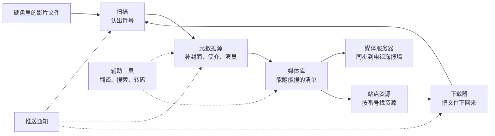

# 接外部服务，一共三步

AMMDS 自己不生产影片资料，也不替你下载文件。想让它自动补封面、找资源、推消息，就要在「集成应用」里把外部服务一个一个接进来。

这一页讲通用接法：不管接的是资料网站还是下载软件，流程都是**启用 → 填资料 → 测试**三步。每一项具体怎么填，看本栏目后面几页。

## 先说清楚：什么是集成应用

> **集成应用**：AMMDS 里统一管理外部服务的地方。你在配置页填好地址与账号，AMMDS 就按你的设置去访问那个服务。

> **外部服务**：不是 AMMDS 自带的功能，而是另一个网站或另一台机器上的程序，比如资料网站、下载软件、播放器。你把它们的地址和账号告诉 AMMDS，两边就连起来了。

> **设置项**：配置页上要你填的框、要你打开的开关。每一项在对应页面里都有说明表。

## 六类集成，各管一件事

侧边栏按用途分成六类，名称与后台「集成应用」菜单一一对应：

| 分类（菜单名） | 后台路由 | 管什么 | 包含哪些 |
| --- | --- | --- | --- |
| 元数据 | `/admin/integration/metadata` | 影片、剧集、演员的封面、简介、演员表 | MetaTube、TMDB、TheTVDB、Bangumi、ThePornDB、TheJavDB、R18.dev、FANZA DMM、麻豆 |
| 站点资源 | `/admin/integration/siteIndexer` | 去哪些站点找资源 | M-Team、NexusPHP、Rousi、FSM、Prowlarr、BitMagnet |
| 下载器 | `/admin/integration/torrentDownloader` | 找到的资源交给谁下载 | qBittorrent、Transmission、IYUU |
| 媒体服务器 | `/admin/integration/mediaServer` | 整理好的资料同步到哪个播放器 | Jellyfin、Emby |
| 推送通知 | `/admin/integration/pushNotification` | 事情办完了通知谁 | Bark、Telegram、Webhook |
| 辅助工具 | `/admin/integration/auxiliaryTools` | 让识别更准、跑得更顺的小工具 | FFmpeg、翻译、DeepSeek、VibeVoice、MeiliSearch、FlareSolverr、高德地图、云存储 |

## 这些服务是怎么串起来的

六类集成不是孤立的，日常用得最多的主线有两条，配合起来看更容易明白该先配哪个：

- **实线是主线一「整理」**：文件进来 → 扫描认号 → 找资料源补全 → 进媒体库 → 同步给播放器。
- **实线是主线二「补片」**：媒体库里的片子没资源 → 站点资源去搜 → 下载器下载 → 下载目录被扫描接住，回到主线一。
- **虚线是帮手**：通知在各个环节给你发消息；辅助工具（翻译、全局搜索、转码）在背后帮忙，不配也能走通主线。

:::note[还有一个分组]
侧边栏里另有「云端同步」分组，用来把配置备份到网盘或对象存储，不参与补资料这条链路。
:::

## 哪些必配，哪些选配

按你想做的事对照着看，不用的可以先不管：

| 你想做的事 | 必须配的 | 可以暂时不配的 |
| --- | --- | --- |
| 让 AMMDS 认出片名、补上封面简介 | 至少一个元数据源，并跑一次刮削任务 | 多开几个源能提高命中率，但一个也能用 |
| 找资源并自动下载 | 至少一个站点资源 + qBittorrent | Prowlarr、BitMagnet 属于兜底，可后配 |
| 在电视上看到整齐的海报墙 | Jellyfin 或 Emby 其中一个 | 两个都配也可以，播放统计会合并 |
| 手机上收到通知 | 任意一个推送渠道，并打开通知总开关 | Telegram 额外支持机器人指令，不强制 |
| 让文件能被扫描、能被转码 | FFmpeg（默认已启用） | 不转码就不用动它 |
| 让顶部搜索框能搜到东西 | MeiliSearch | 不配也能用列表筛选，但全局搜索会是空的 |

:::tip[一条一条加]
不建议一次全开。先配一个元数据源跑通，再往下加，出问题容易定位。
:::

## 一步一步做

1. **打开**「集成应用」，在左侧展开对应分类，点进要接的那一项。
2. **打开「启用状态」开关**。只填内容不开开关，这项不会参与任何任务。
3. **填资料**：服务地址、密钥 / 令牌、账号密码等。地址和密钥都由对方网站提供：地址一般是它登录后的网址，密钥要去它的「设置 / API」一类页面自己生成，AMMDS 不会替你申请。填完点右上角**保存配置**，页面提示保存成功后才生效。
4. **打开子开关**：不少项还有「影视检索」「剧集搜索」「元数据检索」这类小开关，按你的用途一并打开再保存。
5. **点「连接测试」**，确认地址能访问；再点「检索测试 / 搜索测试 / 番号检索」，确认真的能拿到数据。

:::warning[「能访问」不等于「能拿到数据」]
多数连接测试只要对方服务器回了任何一句话就算通过，即使对方回的是「没权限」也算通过。所以连接测试过了但检索还是空的，别再查网络，去查密钥、额度、子开关和关键词。
:::

## 设置项说明

所有集成页的配置项都由下面这几类控件组成，含义是通用的：

| 设置项 | 要填什么 | 不填 / 填错会怎样 |
| --- | --- | --- |
| 启用状态 | 打开开关 | 不打开，后面的地址、密钥填了也不生效 |
| 服务地址 | 对方服务的网址，要带 `http://` 或 `https://` | 留空或写错，连接测试直接失败；装在容器里时写 `127.0.0.1` 会指到自己身上 |
| 密钥 / 令牌 / API Key | 对方网站给你的一串字符，相当于一把钥匙，谁拿到谁能用你的身份访问 | 留空或填错，通常表现为「能连上但检索为空」，或返回 401 / 403（意思是对方不认这把钥匙） |
| 账号 / 密码 | 下载器、媒体服务器的登录信息 | 填错表现为「连接测试通过、获取信息失败」 |
| 子开关（影视检索、剧集搜索、榜单采集、元数据检索） | 按用途打开 | 不开，插件不参与对应任务，例如剧集始终检索不到 |
| 请求间隔 | 两次请求之间最少隔多少毫秒 | 填太小会被站点当成「问得太快」而限速，表现为频繁超时或返回 429 |
| 语言 / 检索语言 | 想拿回来的文字语种，如 `zh-CN` | 填错不会报错，只是取不到对应翻译，会退回原文 |

配置卡片右上角还有两个按钮：

| 按钮 | 作用 |
| --- | --- |
| 刷新配置 | 丢掉没保存的修改，重新读一遍当前保存的值 |
| 保存配置 | 把页面上全部内容提交，全部成功才提示「配置保存成功」 |

:::note[保存之后不会回头补]
配置保存后只对**以后**的任务生效，不会自动回补已经跑完的扫描或刮削。改了优先级、语言、图片地址之后，要重新跑一次刮削任务才能看到新结果。
:::

## 保管好你的钥匙

下面这些属于凭据（也就是前面说的「钥匙」），泄露后可能被别人消耗你的额度，或者以你的身份访问站点：

- MetaTube 的令牌与各翻译服务的密钥
- TMDB 的授权码
- TheTVDB 的密钥与订阅 PIN
- Bangumi 的授权令牌
- ThePornDB 的密钥与 Stash 客户端密钥
- M-Team 的 PassKey、存取令牌与临时授权码
- 各站点的站点令牌、PassKey、API TOKEN
- IYUU、Telegram、Bark 的令牌

几条要紧的：

- 凭据存在你自己的数据库里，配置页会显示当前保存的值。请限制后台账号与数据库的访问权限，备份文件也要收好。
- 不要把后台管理地址直接开到公网上。
- **不要在截图、问题反馈、群聊或日志里粘贴明文密钥**。怀疑泄露时，先去对应网站吊销，再生成新的填回来。
- 用不到的项建议关掉并清空密钥。
- TMDB 授权完成后，页面只显示账户 ID 和令牌的最后 4 位，不会显示完整令牌；Bangumi 的令牌在授权跳回来自动填好，不用手工复制。

## 出问题了怎么办

- **保存了还是不起作用**：先看「启用状态」和相关子开关是不是都打开并保存了。有些项要两个开关同时打开。
- **连接测试失败**：检查服务地址的协议和端口有没有写错；装在 Docker 里的 AMMDS，别把地址写成 `127.0.0.1`；再确认这台机器能不能出网。
- **连接测试通过但检索是空的**：多半是密钥无效、额度用尽、子开关没开，或者关键词不是该源能识别的编号格式。
- **返回 401 或 403**：令牌过期或权限不足，去对方站点重新生成。
- **返回 429 或经常超时**：被站点限速了，把请求间隔调大。
- **图片显示不出来**：图片地址被网络挡住，或者站点做了防盗链。

## 接着看

- [影片资料从哪里来](./metadata.md)
- [去哪里找资源](./indexer.md)
- [让资源自动下载](./downloader.md)
- [同步到电视上看](./media-server.md)
- [消息推送到手机](./notification.md)
- [让识别更准的小工具](./auxiliary.md)
