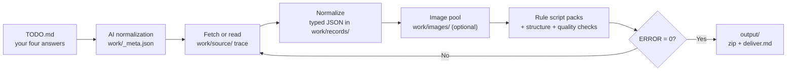

# AI production guide

To turn data from a site, an API or your own files into a backup package AMMDS can import, you do not need to memorize fields or zip structure. Just **answer four questions → copy a prompt to AI → verify against a checklist**. Generation and self-checks are handled by the rules and zero-dependency scripts in the template repo; you only set the goal and accept the result.

The authoritative field and format definitions are in [Backup package spec](./spec.md); this page only covers how to get AI to do the work.

## 1. Get the template repo

The template compresses "make a backup package from this data" into **four blanks + one sentence**:

**https://github.com/QYG2297248353/AMMDS-BackupPackage.git**

Clone or download it. These are the files that matter to you:

| File | Used by | Purpose |
| --- | --- | --- |
| `TODO.md` | You | Answer four questions and save |
| `AI.md` | AI | The execution contract after it hears "complete the todo" |
| `Rule/AI备份包生成规范.md` | AI | The only format authority: field tables, rules, self-check list |
| `tools/auto_backup.py` | AI | Init, pre-check, pack, self-check (Python 3.8+, no third-party packages) |
| `docs/示例-TODO.md` | You | A filled-in TODO example |
| `output/` | Delivery | `*.zip` packages + `deliver.md` report |

You can skip cloning and just send the spec to AI using the "bring your own data" note below, but the template makes self-checking easier and is recommended.

## 2. Answer four questions

Open `TODO.md`. Only four things are yours to decide:

| Question | What you answer | Why it must be asked |
| --- | --- | --- |
| Q1 Where is the data | Site / API URL, how many, which items | The target cannot be guessed from files |
| Q2 Which package | One of `movie` / `actor` / `comic` / `novel` | Decides `manifest.type` and the whole field structure |
| Q3 What about images | `pack` (into the zip) / `link` (external URLs only) / `none` | Decides package size and whether images are downloaded |
| Q4 Who fetches the data | You already have data files, or AI should scrape | Decides conversion vs scraping pipeline |

Everything else — field mapping, directory layout, filename sanitizing, `manifest.json`, `imageFiles` registration, `sha256`, date formats, enum codes, matching keys — is handled by AI according to the spec. **You do not need to worry about it.**

For images: a comic / album **requires `pack` for a complete migration**; `link` keeps the package tiny but depends on the source site staying online; `none` includes no images.

## 3. Copy this prompt to AI

Copy the whole block below to any AI coding assistant, replacing the bracketed parts with your situation:

```text
Please follow these specs and turn the crawled data into a standard AMMDS backup package.

1. Authoritative specs (format details come from these, never from memory):
   - Fetch the template repo https://github.com/QYG2297248353/AMMDS-BackupPackage.git
     and read Rule/AI备份包生成规范.md and AI.md; if unavailable locally, use WebFetch to get the raw text.
   - You may cross-check fields at https://ammds.lifebus.top/open-api/backup-restore/spec

2. My goal (replace with the real values):
   - Data source: <site / API / local data file path>
   - Package type: one of <movie | actor | comic | novel>
   - Image strategy: <pack | link | none>
   - Scope: <e.g. first 100 items / all items in one category>

3. Execution requirements:
   - Run `python tools/auto_backup.py todo` first; if it fails, report the errors to me
     instead of guessing my answers.
   - Scrape one list page and one detail page first to confirm the real structure,
     then write the scraper; save raw responses under work/source/ as a trace.
   - Normalize data into work/records/<type>.json, following the ten rules:
     * movie items have a uniqueid array and originalTitle; actor has name; comic/novel has title.
     * integer fields are integers (120, not 120.0); dates yyyy-MM-dd; enums are codes only.
     * movie.poster is an array, actor.poster is a single value, comic/novel.cover is a single value.
     * omit fields you cannot obtain; never write placeholders like "unknown" or "-",
       and never invent IDs, ISBNs, synopses or images.
   - For `pack`, place images under work/images/ by ref path and confirm they are real image
     bytes, not a 403 HTML page.
   - Run `python tools/auto_backup.py build` to pack and self-check; fix all ERRORs before
     delivery, and never deliver a package that failed self-check.
   - On delivery report: zip path, size, SHA-256, item count, image count, ERROR=0,
     plus the import path and a list of remaining risks.

4. Do not:
   - register http(s) external links in imageFiles; hand-write count or imageFiles in manifest.json.
   - write any Cookie / Token / credentials into files.
   - overwrite the Rule/ files or my original data files.
```

If you already have data files and need no scraping, drop steps 2 and 4 in section 3 and say "data files are at `<path>`, please read and convert them".

## 4. What AI will do

Understanding the flow helps you verify the result:



Key point: **`work/source/` is a trace only; `work/records/` and `work/images/` are what get packed.** Deleting `work/` and `output/` and rerunning does not affect the rules (`init` is idempotent), but never touch `Rule/`.

## 5. Verification checklist

Before importing, check the delivered package:

- **Parse preview passes**: AMMDS → System → Backup & restore → Data import → pick the zip → "Parse preview" shows **validation passed**.
- **Conflict strategy**: for a first import choose `skip` or `overwrite`; `merge` keeps existing data and fills gaps.
- **`failed=0`**: check the failure count after import — 0 means clean.
- **Counts match**: the delivered item count matches the import result; movies match by `uniqueid`, actors by exact `name`, and a differently written ID or an extra space counts as a new record.
- **Images work**: `pack` packages work offline; for `link` packages check the URLs still open.
- **No placeholders**: sample a few records for `"unknown"`, `"-"` and similar filler.

## 6. Common questions

- **AI asks to invent a few items to fill a quota**: do not. Fewer but real records beat fake IDs and ISBNs that become dirty data after import.
- **`todo` pre-check fails**: fill in the missing answers from the ERROR lines; AI should ask you only about the gaps, at most three questions.
- **`build` reports missing images**: under `pack`, some images were not downloaded — download them, switch to external links (needs your approval), or change the whole package to `link`.
- **The package is large / slow**: depends on image volume. Metadata-only packages are tens of KB to a few MB; a full comic library can be hundreds of MB to GB, and the delivery report states the size.
- **No Python available**: the template scripts need only the Python 3.8+ standard library; on Windows use `run.cmd init / todo / build`.
- **Want to verify the template framework**: run `python tools/auto_backup.py selftest` with built-in data; it overwrites `work/` and `output/`, so do not run it right before delivery.
- **Import rejected**: check [spec · validation](./spec.md#8-validation-what-gets-rejected) item by item — the most common causes are wrong `format` / `type` and a mismatched `count`.

## Next

- [Backup package spec](./spec.md)
- [Backup package structure](./overview.md)
- [Template repository README](https://github.com/QYG2297248353/AMMDS-BackupPackage)
