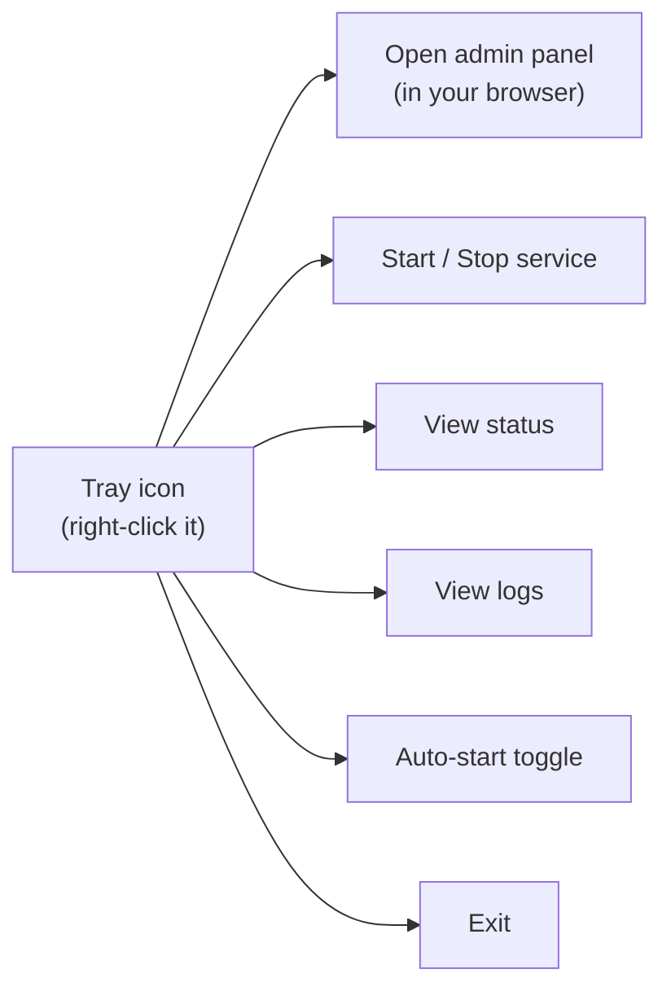

# Using the Windows installer (Launcher)

If you don't want to type commands or install Docker, use the Windows installer. After a double-click installation, AMMDS behaves like a regular program on your PC: **it sits in the system tray in the bottom-right corner**, and clicking the icon lets you start, stop, and open the admin panel.

Under the hood, the installer is a "Launcher" that wraps the AMMDS main program and manages it for you. What you get in the browser is exactly the same as the Docker or binary builds.

> **Launcher**: a small manager that runs AMMDS for you. You give instructions by clicking the tray icon, and it starts or stops the actual program and shows you its status.

## Requirements

| Item | Requirement |
| --- | --- |
| OS | Windows 10 (1903 or later) or Windows 11, 64-bit |
| Runtime | No Java and no Docker needed; the installer brings everything along |
| Permissions | Administrator rights during installation (to write to the install directory and register auto-start); normal rights for daily use |
| Network | Fetching metadata and finding resources require internet access |

## Download

Download the latest `.exe` installer from the official releases page: https://github.com/QYG2297248353/AMMDS-Launcher/releases

Download from the official releases page only. Third-party repackaged installers may bundle other programs, or use a data layout that doesn't match the current version.

## Install

1. Double-click the installer and allow the administrator-rights request.
2. Choose an install location in the wizard; defaults are fine for everything else.
3. If you check "Start with Windows", AMMDS starts silently in the background every time the PC boots.
4. When installation finishes, the AMMDS icon appears in the tray; double-click it or right-click to get started.

## Tray management

Day-to-day operation happens on the tray icon:

| Tray action | What it does |
| --- | --- |
| Open admin panel | Opens the AMMDS admin page in your default browser; most day-to-day work happens here |
| Start / Stop | Runs or stops the background service; once stopped, the page is unreachable in the browser |
| View status | A quick look at whether the service is running and how much resource it uses |
| View logs | Opens the run log directly — handy when troubleshooting |
| Exit | Quits AMMDS completely and stops the background service |

:::tip[Closing the browser window is not quitting]
Clicking the × in the browser only closes the page; AMMDS keeps running in the tray (scanning, scraping and other tasks continue). To actually stop it, exit from the tray icon or click "Stop service".
:::

## Where your data lives

As with every other install method, AMMDS keeps your library data on your own disk:

| Location | Contents |
| --- | --- |
| Data directory chosen at install | `data/` (images, cache, subtitles, logs, recovery key, dependencies) and `db/` (database), created automatically |
| Your media directory | The video files to scan and organize — anywhere you like; you point AMMDS to it in the admin panel |
| Default data directory | If you clicked through the wizard, data lands in the current user's application data folder |

:::warning[Two things to remember]
1. **Don't put media inside the data directory.** Keep media in a separate folder so cleanup never touches your videos.
2. **Back up these two**: `db/` and `data/`. Copy them out before reinstalling Windows and put them back afterwards — everything comes with them.
:::

## Changing the port and upload size

The installer runs the same AMMDS program, so every startup setting in [Ports, upload limits and other startup settings](./settings.md) applies here too — fill them in the settings screen the Launcher provides; where exactly depends on your Launcher version. Restart the service from the tray for changes to take effect.

## Upgrading

When a new version ships, install the new package over the old one; the data directory is untouched. As always, back up `db/` and `data/` before upgrading.

## Uninstall

Use Windows "Settings → Apps → Installed apps" and uninstall AMMDS. Uninstalling removes only the program; the data in `data/` and `db/` stays. Delete it manually when you're sure you no longer need it.

## Troubleshooting

| Symptom | Likely cause | Fix |
| --- | --- | --- |
| Installer says access denied | Administrator rights not granted | Right-click the installer and choose "Run as administrator" |
| Tray icon disappeared | The program was exited, or the icon is hidden | Expand the hidden icons with "^" in the taskbar; otherwise relaunch from the Start menu |
| "Open admin panel" does nothing | Service not started, or port taken | Check in the tray that the service is running; if the port conflicts, change the access port and start again |
| No auto-start after reboot | Option unchecked, or blocked by security software | Re-enable auto-start from the tray menu; check the security software's block log |
| Page opens but looks broken | Stale page cache | Force-refresh once (`Ctrl` + `F5`) |
| Anything else | — | Find it by symptom in [FAQ: answers by symptom](../faq.md) |

## What's next

- [Ports, upload limits and other startup settings](./settings.md)
- [Setup wizard: first configuration](./install-wizard.md)
- [First launch: sign in and basic setup](./first-login.md)
