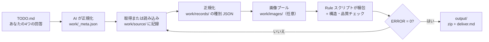

# AI 作成ガイド

あるサイト、API、あるいは自分でまとめたデータを AMMDS が取り込めるバックアップパッケージにしたいとき、項目名や zip 構成を覚える必要はありません。**4つの質問に答える → プロンプトを AI に渡す → 一覧で確認する**だけでできます。生成と自己検証はテンプレートリポジトリの規則とゼロ依存スクリプトが担い、あなたは目標を与えて結果を受け取るだけです。

項目と形式の権威ある定義は[バックアップパッケージ仕様](./spec.md)にあります。このページは AI に仕事をさせる方法だけを扱います。

## 1. テンプレートリポジトリを用意する

テンプレートは「このデータからバックアップパッケージを作る」を**4つの空欄 + 一言**に圧縮します：

**https://github.com/QYG2297248353/AMMDS-BackupPackage.git**

クローンまたはダウンロードして、関係するファイルはこれだけです：

| ファイル | 誰が使う | 役割 |
| --- | --- | --- |
| `TODO.md` | あなた | 4つの質問に答えて保存 |
| `AI.md` | AI | 「やることリストを完了して」と言われた後の実行契約 |
| `Rule/AI备份包生成规范.md` | AI | 形式の唯一の権威：項目表、鉄則、自己検証一覧 |
| `tools/auto_backup.py` | AI | 初期化・事前チェック・梱包・自己検証（Python 3.8+ のみ、追加ライブラリ不要） |
| `docs/示例-TODO.md` | あなた | 記入済み TODO の例 |
| `output/` | 成果物 | `*.zip` パッケージ + `deliver.md` 報告書 |

クローンせず、後述の「手元のデータを使う」方法で規範だけ AI に送っても構いません。ただしテンプレートのほうが自己検証が楽なので推奨します。

## 2. 4つの質問に答える

`TODO.md` を開きます。あなたが決めるのは4つだけです：

| 質問 | 答える内容 | なぜ必要か |
| --- | --- | --- |
| Q1 データの出所 | サイト / API の URL、件数、対象 | ファイルからは推測できない |
| Q2 どのパッケージか | `movie` / `actor` / `comic` / `novel` から1つ | `manifest.type` と項目構造を決める |
| Q3 画像はどうするか | `pack`（zip に詰める）/ `link`（外部リンクのみ）/ `none`（画像なし） | 容量とダウンロード要否を決める |
| Q4 誰がデータを取得するか | 既にファイルがある / AI にクロールさせる | 変換かクロールかの経路を決める |

あとは項目対応、ディレクトリ構成、ファイル名の安全化、`manifest.json`、`imageFiles` 登録、`sha256`、日付形式、列挙 code、照合キー——すべて AI が規範に従って処理します。**あなたが気にする必要はありません。**

画像について：漫画 / アルバムの**完全な移行には `pack` が必須**です。`link` はパッケージが小さい反面、元サイトの画像が長期公開されている必要があります。`none` は画像を持ちません。

## 3. 次のプロンプトを AI にコピーする

下のブロック全体を任意の AI コーディングアシスタントに貼り付け、括弧内を自分の状況に置き換えてください：

```text
次の仕様に従って、クロールデータを AMMDS 標準バックアップパッケージにしてください。

1. 権威ある仕様（形式の詳細はこれを優先し、記憶に頼らないこと）：
   - テンプレートリポジトリ https://github.com/QYG2297248353/AMMDS-BackupPackage.git を取得し、
     Rule/AI备份包生成规范.md と AI.md を読む。ローカルに無ければ WebFetch で原文を取得する。
   - 項目は https://ammds.lifebus.top/open-api/backup-restore/spec で照合してもよい。

2. 私の目標（実際の値に置き換えること）：
   - データ出所：<サイト / API / ローカルデータのパス>
   - パッケージ種別：<movie | actor | comic | novel> から1つ
   - 画像戦略：<pack | link | none>
   - 範囲：<例：先頭100件 / あるカテゴリの全件>

3. 実行要件：
   - まず `python tools/auto_backup.py todo` を実行し、失敗した場合は推測せずエラーを私に報告する。
   - まず一覧ページと詳細ページを1つずつ取得して実際の構造を確認してからクローラーを書く。
     生レスポンスは work/source/ に記録する。
   - データを work/records/ 配下の種別 JSON に正規化し、十の鉄則に従う：
     * movie は uniqueid 配列と originalTitle、actor は name、comic/novel は title が必須。
     * 整数項目は整数（120 であって 120.0 ではない）；日付は yyyy-MM-dd；列挙は code のみ。
     * movie.poster は配列、actor.poster は単値、comic/novel.cover は単値。
     * 取得できない項目は省略し、「未知」や「-」などのプレースホルダーを書かない。
       番号・ISBN・あらすじ・画像を捏造しないこと。
   - pack の場合は work/images/ に ref のパスどおり画像を置き、403 ページではなく本物の画像であることを確認する。
   - `python tools/auto_backup.py build` で梱包・自己検証し、ERROR が0になるまで修正する。
     自己検証に失敗したパッケージは絶対に渡さない。
   - 渡すときに報告する：zip のパス、容量、SHA-256、件数、画像数、ERROR=0、
     および取り込み手順と残リスク一覧。

4. やってはいけないこと：
   - http(s) 外部リンクを imageFiles に登録しない。manifest.json の count や imageFiles を手書きしない。
   - Cookie / Token / 認証情報をファイルに書き込まない。
   - Rule/ 配下のファイルや私の元データを上書きしない。
```

手元にデータファイルがありクロールが不要な場合は、第3節の2と4を外し、「データは `<パス>` にあります。読んで変換してください」と付け加えればよいです。

## 4. AI が何をするか

流れを知っていると結果を確認しやすくなります：



要点：**`work/source/` は記録専用、`work/records/` と `work/images/` が梱包対象**です。`work/` と `output/` を消して再実行しても規則には影響しません（`init` は冪等）。ただし `Rule/` は触らないでください。

## 5. 確認一覧

取り込む前に、渡されたパッケージを確認します：

- **解析プレビューが通る**：AMMDS → システム → バックアップと復元 → データ取り込み → zip を選択 →「解析プレビュー」が**検証通過**を表示。
- **競合策略**：初回は `skip` または `overwrite` を選択。`merge` は既存データを残して空欄を補います。
- **`failed=0`**：取り込み後の失敗件数が0であること。
- **件数が合う**：報告書の件数と取り込み結果が一致。映画は `uniqueid`、演者は `name` の完全一致で照合され、番号の書き方違いや余分な空白は新規扱いになります。
- **画像が使える**：`pack` はオフラインでも閲覧可。`link` は URL が今も開けるか確認します。
- **プレースホルダーが無い**：数件を抜き取り、`"未知"`、`"-"` などの埋め文字が無いか見ます。

## 6. よくある質問

- **AI が数を揃えるために捏造を提案してきた**：やめましょう。取り込み後に汚いデータになる偽の番号や ISBN より、少ないながら本物のほうがましです。
- **`todo` の事前チェックが通らない**：ERROR 行に従って4つの質問を補う。AI が聞くのは足りない項目だけで、最大3問のはずです。
- **`build` が画像不足を報告**：`pack` では画像がダウンロードされていません。補う、外部リンクに変える（あなたの同意が必要）、またはパッケージ全体を `link` に変える、のいずれかです。
- **パッケージが大きい / 時間がかかる**：画像量によります。メタデータだけなら数十 KB〜数 MB、漫画ライブラリ全体なら数百 MB〜GB になることもあり、報告書に容量が書かれます。
- **Python が無い**：テンプレートは Python 3.8+ の標準ライブラリだけ。Windows なら `run.cmd init / todo / build` が使えます。
- **テンプレート自体を検証したい**：`python tools/auto_backup.py selftest` を実行します。内蔵データで一通り走りますが `work/` と `output/` を上書きするので、納品直前に走らせないでください。
- **取り込みが拒否された**：[仕様 · 検証](./spec.md#8-検証何が拒否されるか)を項目ごとに照合してください。よくあるのは `format` / `type` の書き間違いと `count` の不一致です。

## 次に見る

- [バックアップパッケージ仕様](./spec.md)
- [バックアップパッケージの構造](./overview.md)
- [テンプレートリポジトリ README](https://github.com/QYG2297248353/AMMDS-BackupPackage)
