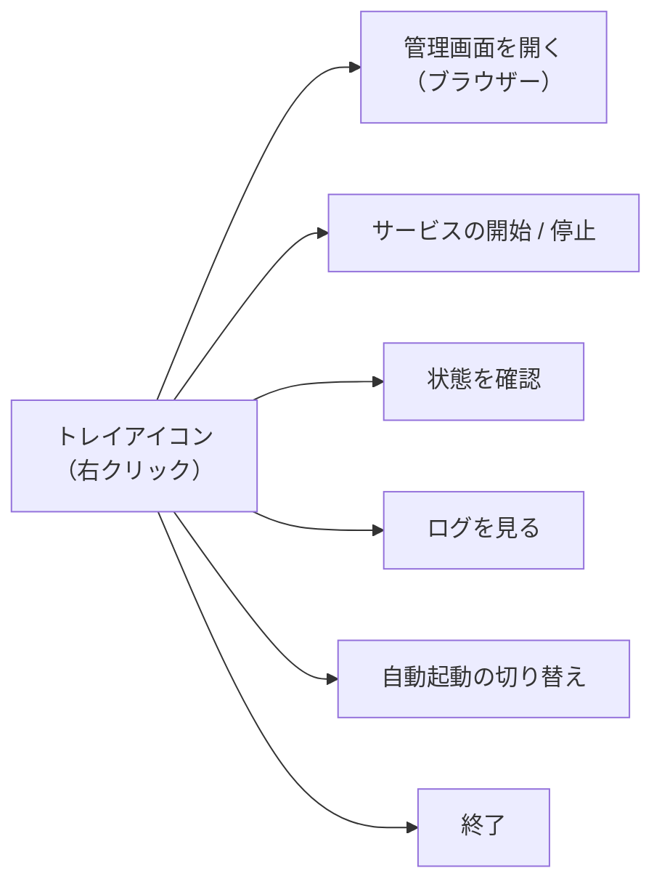

# Windows インストーラー（ランチャー）を使う

コマンドを打ちたくない、Docker を入れたくない、という方は Windows インストーラーを。ダブルクリックでインストールすると、AMMDS は普通のソフトと同じように振る舞います。**画面右下のシステムトレイに常駐し**、アイコンをクリックするだけで起動・停止・管理画面を開けます。

インストーラーの中身は「ランチャー」と呼ばれる小さな管理プログラムで、AMMDS 本体を包んで代わりに管理してくれます。ブラウザーから使える機能は、Docker 版・バイナリ版とまったく同じです。

> **ランチャー**：AMMDS 本体の代わりに起動・停止を担当する「管理人」のようなプログラムです。トレイのアイコンで指示を出すと、実際に動く本体を制御して状態を見せてくれます。

## 動作環境

| 項目 | 要件 |
| --- | --- |
| OS | Windows 10（1903 以降）または Windows 11、64 ビット |
| 実行環境 | Java も Docker も不要。インストーラーが全部持っています |
| 権限 | インストール時のみ管理者権限が必要（インストール先への書き込みと自動起動の登録）。日々の利用は通常権限でOK |
| ネットワーク | 情報の自動取得やリソース検索には外部ネットワークへの接続が必要 |

## ダウンロード

公式リリースページから最新の `.exe` インストーラーをダウンロードしてください：https://github.com/QYG2297248353/AMMDS-Launcher/releases

ダウンロードは必ず公式リリースページから。第三者が再パッケージしたインストーラーは、余計なプログラムを同梱していたり、現行版とデータ構造が合わなかったりする恐れがあります。

## インストール

1. インストーラーをダブルクリックし、管理者権限の要求を許可します。
2. ウィザードに従ってインストール先を選びます。他は初期設定のままで大丈夫。
3. 「Windows 起動時に自動開始」にチェックを入れると、PC の起動後に AMMDS がバックグラウンドで静かに立ち上がります。
4. インストールが終わるとトレイに AMMDS のアイコンが現れます。ダブルクリックまたは右クリックで使い始めましょう。

## トレイでの操作

日々の操作はトレイアイコンから行います：

| トレイ操作 | 内容 |
| --- | --- |
| 管理画面を開く | 既定のブラウザーで AMMDS の管理ページを開きます。普段の整理作業はここで |
| 開始 / 停止 | バックグラウンドサービスを起動または停止します。停止するとブラウザーからはページが見えなくなります |
| 状態を確認 | サービスの稼働状況とリソース使用量をひと目で確認 |
| ログを見る | 実行ログを直接開きます。トラブル調査に便利 |
| 終了 | AMMDS を完全に終了し、バックグラウンドサービスも停止します |

:::tip[ブラウザーの × は終了ではない]
ブラウザーの右上の × はページを閉じるだけです。AMMDS はトレイに常駐し、スキャンや取得などのタスクは続行します。本当に止めたいときは、トレイから終了するか「サービスを停止」してください。
:::

## データの保存場所

どの導入方法でも同じく、AMMDS はデータをあなた自身のディスクに保存します：

| 場所 | 中身 |
| --- | --- |
| インストール時に選んだデータフォルダー | `data/`（画像・キャッシュ・字幕・ログ・復旧キー・依存プログラム）と `db/`（データベース）。自動で作成されます |
| メディアフォルダー | スキャン対象の映像ファイル。好きな場所に置き、管理画面でパスを指定します |
| 既定のデータフォルダー | ウィザードで次々と進めた場合は、現在のユーザーのアプリデータフォルダー配下になります |

:::warning[忘れがちな 2 つのこと]
1. **メディアをデータフォルダーに入れない**。映像は別フォルダーに置き、データ整理の際に誤って消えないようにします。
2. **バックアップはこの 2 つ**：`db/` と `data/`。OS 再インストールの前にコピーし、戻せばそのまま復元できます。
:::

## ポートやアップロード上限を変える

インストーラー版も同じ AMMDS なので、[ポート・アップロード上限などの起動設定](./settings.md)の各項目がそのまま使えます。ランチャーが用意した設定画面に入力し、トレイからサービスを再起動すると反映されます。入力箇所の位置はお使いのバージョンの画面に準じます。

## アップグレード

新しいバージョンが出たら、新しいインストーラーで上書きインストールするだけです。データフォルダーは影響を受けません。念のため、上書き前に `db/` と `data/` をバックアップしてください。

## アンインストール

Windows の「設定 → アプリ → インストールされているアプリ」から AMMDS をアンインストールします。削除されるのはプログラム本体だけで、`data/` と `db/` のデータは残ります。不要を確定してから手動で削除してください。

## うまくいかないとき

| 症状 | 原因の見当 | 対処 |
| --- | --- | --- |
| インストール時に権限不足のエラー | 管理者権限を許可していない | インストーラーを右クリックし「管理者として実行」 |
| トレイアイコンが消えた | プログラムが終了したか、アイコンが隠れている | タスクバーの「^」で隠しアイコンを確認。なければスタートメニューから再起動 |
| 「管理画面を開く」が反応しない | サービス未起動、またはポート競合 | トレイでサービスの稼働を確認。ポートが重なっているならアクセスポートを変えて再起動 |
| 再起動後に自動起動しない | チェックを忘れた、またはセキュリティソフトにブロックされた | トレイメニューで自動起動をオンにし、セキュリティソフトのブロック履歴を確認 |
| ページは開くが表示がおかしい | ページのキャッシュが古い | 強制再読み込み（`Ctrl` + `F5`） |
| その他 | — | [よくある質問](../faq.md)で症状から探してください |

## 次に見る

- [ポート・アップロード上限などの起動設定](./settings.md)
- [初回起動：ログインと基本設定](./first-login.md)
