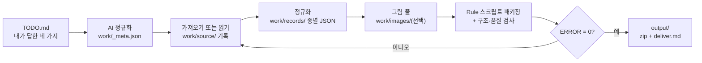

# AI 제작 가이드

어떤 사이트, API, 또는 직접 정리한 데이터를 AMMDS가 가져올 수 있는 백업 패키지로 만들고 싶을 때 필드 이름이나 zip 구조를 외울 필요는 없습니다. **네 가지 질문에 답하기 → 프롬프트를 AI에 붙여넣기 → 목록으로 확인**하면 됩니다. 생성과 자체 검사는 템플릿 저장소의 규칙과 의존성 없는 스크립트가 맡고, 당신은 목표만 주고 결과를 받으면 됩니다.

필드와 형식의 권위 있는 정의는 [백업 패키지 규격](./spec.md)에 있습니다. 이 페이지는 AI가 일을 하게 하는 방법만 다룹니다.

## 1. 템플릿 저장소 준비

템플릿은 "이 데이터로 백업 패키지를 만들어 줘"를 **빈칸 네 개 + 한 마디**로 줄여 놓았습니다:

**https://github.com/QYG2297248353/AMMDS-BackupPackage.git**

복제하거나 다운로드하면 다음 파일만 알면 됩니다:

| 파일 | 누가 쓰나 | 역할 |
| --- | --- | --- |
| `TODO.md` | 당신 | 네 가지 질문에 답하고 저장 |
| `AI.md` | AI | "할 일을 완료해 줘"라는 말을 들은 뒤의 실행 계약 |
| `Rule/AI备份包生成规范.md` | AI | 형식의 유일한 권위: 항목 표, 철칙, 자체 검사 목록 |
| `tools/auto_backup.py` | AI | 초기화·사전 점검·패키징·자체 검사(Python 3.8+만, 서드파티 불필요) |
| `docs/示例-TODO.md` | 당신 | 작성된 TODO 예시 |
| `output/` | 산출물 | `*.zip` 패키지 + `deliver.md` 보고서 |

복제하지 않고 아래의 "손 안의 데이터 쓰기" 방법으로 명세만 AI에 보내도 됩니다. 다만 템플릿이 자체 검사가 편하므로 권장합니다.

## 2. 네 가지 질문에 답하기

`TODO.md`를 엽니다. 당신이 정할 것은 네 가지뿐입니다:

| 질문 | 답할 내용 | 왜 물어야 하나 |
| --- | --- | --- |
| Q1 데이터 출처 | 사이트 / API 주소, 건수, 대상 | 파일만으로는 짐작할 수 없다 |
| Q2 어떤 패키지 | `movie` / `actor` / `comic` / `novel` 중 하나 | `manifest.type`과 전체 항목 구조를 정한다 |
| Q3 그림은 어떻게 | `pack`(zip에 넣기) / `link`(외부 링크만) / `none`(그림 없음) | 패키지 크기와 다운로드 여부를 정한다 |
| Q4 데이터는 누가 가져오나 | 이미 파일이 있다 / AI가 크롤링 | 변환 경로와 크롤링 경로를 정한다 |

나머지 — 항목 매핑, 폴더 구조, 파일명 안전화, `manifest.json`, `imageFiles` 등록, `sha256`, 날짜 형식, 열거형 code, 대조 키 — 는 모두 AI가 명세에 따라 처리합니다. **당신이 신경 쓸 필요가 없습니다.**

그림에 대해: 만화 / 앨범의 **완전한 이전에는 `pack`이 필수**입니다. `link`는 패키지가 작지만 원본 사이트의 그림이 오래 열려 있어야 합니다. `none`은 그림이 없습니다.

## 3. 다음 프롬프트를 AI에 복사

아래 블록 전체를 모든 AI 코딩 어시스턴트에 붙여넣고 괄호 안을 당신의 상황으로 바꾸세요:

```text
다음 명세에 따라 크롤링한 데이터를 AMMDS 표준 백업 패키지로 만들어 주세요.

1. 권위 있는 명세(형식 세부는 이를 우선하고 기억에 의존하지 말 것):
   - 템플릿 저장소 https://github.com/QYG2297248353/AMMDS-BackupPackage.git 를 가져와
     Rule/AI备份包生成规范.md 와 AI.md 를 읽을 것. 로컬에 없으면 WebFetch로 원문을 얻을 것.
   - 항목은 https://ammds.lifebus.top/open-api/backup-restore/spec 에서 대조해도 됨.

2. 내 목표(실제 값으로 교체할 것):
   - 데이터 출처: <사이트 / API / 로컬 데이터 경로>
   - 패키지 종류: <movie | actor | comic | novel> 중 하나
   - 그림 전략: <pack | link | none>
   - 범위: <예: 앞의 100건 / 특정 분류 전체>

3. 실행 요구:
   - 먼저 `python tools/auto_backup.py todo`를 실행하고, 실패하면 추측하지 말고 오류를 나에게 알릴 것.
   - 먼저 목록 페이지와 상세 페이지를 하나씩 가져와 실제 구조를 확인한 뒤 크롤러를 작성할 것.
     원본 응답은 work/source/에 기록할 것.
   - 데이터를 work/records/ 아래의 종별 JSON으로 정규화하고 열 가지 철칙을 지킬 것:
     * movie는 uniqueid 배열과 originalTitle, actor는 name, comic/novel은 title이 필수.
     * 정수 항목은 정수(120이어야지 120.0이 아님); 날짜는 yyyy-MM-dd; 열거형은 code만.
     * movie.poster는 배열, actor.poster는 단일 값, comic/novel.cover는 단일 값.
     * 얻지 못한 항목은 생략하고 "알 수 없음"이나 "-" 같은 자리표시자를 쓰지 말 것.
       번호, ISBN, 줄거리, 그림을 지어내지 말 것.
   - pack이면 work/images/에 ref 경로대로 그림을 두고 403 페이지가 아닌 실제 그림인지 확인할 것.
   - `python tools/auto_backup.py build`로 패키징하고 자체 검사할 것. ERROR가 0이 될 때까지 고치고,
     자체 검사를 통과하지 못한 패키지는 절대 건네지 말 것.
   - 건넬 때 보고할 것: zip 경로, 크기, SHA-256, 건수, 그림 수, ERROR=0,
     그리고 가져오기 절차와 남은 위험 목록.

4. 하지 말 것:
   - http(s) 외부 링크를 imageFiles에 등록하지 말 것. manifest.json의 count나 imageFiles를 손으로 쓰지 말 것.
   - Cookie / Token / 계정 정보를 파일에 쓰지 말 것.
   - Rule/ 아래의 파일이나 내 원본 데이터를 덮어쓰지 말 것.
```

이미 데이터 파일이 있고 크롤링이 필요 없다면 3절의 2, 4번을 빼고 "데이터는 `<경로>`에 있습니다. 읽어서 변환해 주세요"라고 덧붙이면 됩니다.

## 4. AI가 무엇을 하는가

흐름을 알면 결과를 확인하기 쉽습니다:



핵심: **`work/source/`는 기록용이고 `work/records/`와 `work/images/`만 패키지에 들어갑니다.** `work/`와 `output/`를 지우고 다시 실행해도 규칙에는 영향이 없습니다(`init`은 멱등). 다만 `Rule/`은 건드리지 마세요.

## 5. 확인 목록

가져오기 전에 건네받은 패키지를 확인합니다:

- **구문 분석 미리보기 통과**: AMMDS → 시스템 → 백업과 복원 → 데이터 가져오기 → zip 선택 → "구문 분석 미리보기"가 **검증 통과**를 표시.
- **충돌 전략**: 처음 가져올 때는 `skip` 또는 `overwrite`를 선택. `merge`는 기존 데이터를 남기고 빈 값을 채웁니다.
- **`failed=0`**: 가져온 뒤 실패 건수가 0인지 확인.
- **건수가 맞음**: 보고서의 건수와 가져오기 결과가 일치. 영화는 `uniqueid`, 배우는 `name` 완전 일치로 대조되고, 번호 표기가 다르거나 공백이 덧붙으면 새 자료가 됩니다.
- **그림이 열림**: `pack`은 오프라인에서도 볼 수 있습니다. `link`는 URL이 지금도 열리는지 확인.
- **자리표시자가 없음**: 몇 건을 뽑아 `"알 수 없음"`, `"-"` 같은 채움 문자가 없는지 봅니다.

## 6. 자주 묻는 질문

- **AI가 수를 맞추려고 지어내자고 한다**: 하지 마세요. 가져온 뒤 더러운 데이터가 되는 가짜 번호·ISBN보다 적지만 진짜가 낫습니다.
- **`todo` 사전 점검이 안 된다**: ERROR 줄에 따라 네 가지 질문을 채우세요. AI는 빠진 것만, 최대 세 가지 질문을 해야 합니다.
- **`build`가 그림 부족을 보고**: `pack`에서 그림이 다운로드되지 않았습니다. 채우거나, 외부 링크로 바꾸거나(동의 필요), 패키지 전체를 `link`로 바꾸세요.
- **패키지가 크거나 오래 걸린다**: 그림 양에 따릅니다. 메타데이터만 있으면 수십 KB~수 MB, 만화 라이브러리 전체는 수백 MB~GB일 수 있고 보고서에 크기가 적힙니다.
- **Python이 없다**: 템플릿 스크립트는 Python 3.8+ 표준 라이브러리만 필요합니다. Windows에서는 `run.cmd init / todo / build`를 쓸 수 있습니다.
- **템플릿 자체를 검증하고 싶다**: `python tools/auto_backup.py selftest`를 실행하세요. 내장 데이터로 한 바퀴 돌지만 `work/`와 `output/`을 덮어쓰므로 납품 직전에는 돌리지 마세요.
- **가져오기가 거부됐다**: [규격 · 검증](./spec.md#8-검증-무엇이-거부되는가)을 항목별로 대조하세요. 가장 흔한 건 `format` / `type` 오타와 `count` 불일치입니다.

## 다음으로 보기

- [백업 패키지 규격](./spec.md)
- [백업 패키지 구조](./overview.md)
- [템플릿 저장소 README](https://github.com/QYG2297248353/AMMDS-BackupPackage)
