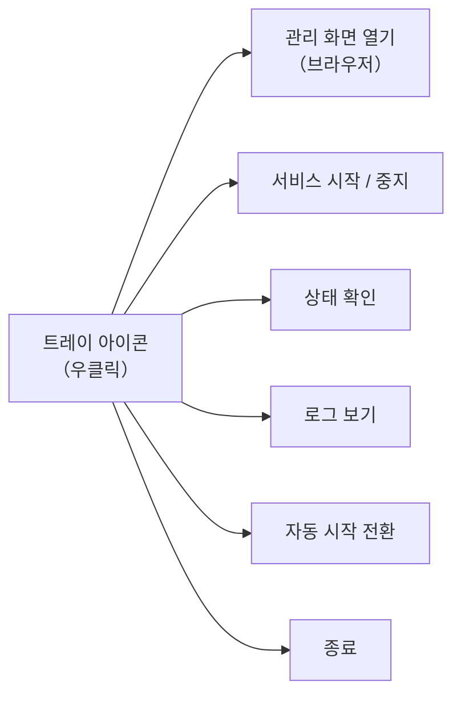

# Windows 설치 패키지(런처) 사용하기

명령어 입력도, Docker 설치도 원하지 않는다면 Windows 설치 패키지를 사용하세요. 더블클릭으로 설치하면 AMMDS는 일반 프로그램처럼 동작합니다. **화면 우측 하단 시스템 트레이에 상주하며**, 아이콘 클릭만으로 시작·중지·관리 화면 열기를 할 수 있습니다.

설치 패키지의 정체는 AMMDS 본체를 감싸서 대신 관리해 주는 "런처"입니다. 브라우저에서 사용하는 기능은 Docker 버전, 바이너리 버전과 완전히 동일합니다.

> **런처**: AMMDS 본체 대신 실행과 중지를 맡아주는 "관리인" 같은 프로그램입니다. 트레이 아이콘으로 지시하면 실제 본체를 제어하고 상태를 보여줍니다.

## 시스템 요구 사항

| 항목 | 요구 사항 |
| --- | --- |
| OS | Windows 10(1903 이상) 또는 Windows 11, 64비트 |
| 실행 환경 | Java도 Docker도 불필요. 설치 패키지가 모두 포함 |
| 권한 | 설치 시에만 관리자 권한 필요(설치 폴더 기록, 자동 시작 등록). 일상 사용은 일반 권한으로 충분 |
| 네트워크 | 정보 자동 수집과 리소스 검색에는 외부 네트워크 연결 필요 |

## 다운로드

공식 릴리스 페이지에서 최신 `.exe` 설치 패키지를 내려받으세요: https://github.com/QYG2297248353/AMMDS-Launcher/releases

다운로드는 반드시 공식 릴리스 페이지에서만. 제3자가 재포장한 설치 패키지는 다른 프로그램이 섞여 있거나, 현재 버전과 데이터 구조가 맞지 않을 수 있습니다.

## 설치

1. 설치 패키지를 더블클릭하고 관리자 권한 요청을 허용합니다.
2. 마법사에 따라 설치 위치를 선택합니다. 나머지는 기본값 그대로 두어도 됩니다.
3. "Windows 시작 시 자동 실행"에 체크하면 PC 부팅 후 AMMDS가 백그라운드에서 조용히 실행됩니다.
4. 설치가 끝나면 트레이에 AMMDS 아이콘이 나타납니다. 더블클릭 또는 우클릭으로 시작하세요.

## 트레이 관리

일상 조작은 트레이 아이콘에서 이루어집니다:

| 트레이 조작 | 내용 |
| --- | --- |
| 관리 화면 열기 | 기본 브라우저에서 AMMDS 관리 페이지를 엽니다. 평소 정리 작업은 여기서 |
| 시작 / 중지 | 백그라운드 서비스를 실행하거나 중지합니다. 중지하면 브라우저에서 페이지가 열리지 않습니다 |
| 상태 확인 | 서비스 실행 여부와 자원 사용량을 한눈에 확인 |
| 로그 보기 | 실행 로그를 바로 엽니다. 문제 해결에 유용 |
| 종료 | AMMDS를 완전히 종료하고 백그라운드 서비스도 중지합니다 |

:::tip[브라우저의 × 는 종료가 아닙니다]
브라우저 우측 상단의 × 는 페이지를 닫는 것일 뿐입니다. AMMDS는 트레이에 계속 머물며 스캔·수집 작업은 계속 진행됩니다. 정말 멈추려면 트레이에서 종료하거나 "서비스 중지"를 누르세요.
:::

## 데이터 저장 위치

어떤 설치 방식이든 AMMDS는 데이터를 사용자의 디스크에 저장합니다:

| 위치 | 내용 |
| --- | --- |
| 설치 시 선택한 데이터 폴더 | `data/`(이미지·캐시·자막·로그·복구 키·의존 프로그램)와 `db/`(데이터베이스). 자동 생성됩니다 |
| 미디어 폴더 | 스캔 대상 영상 파일. 원하는 곳에 두고 관리 화면에서 경로를 지정합니다 |
| 기본 데이터 폴더 | 마법사를 그대로 진행하면 현재 사용자의 앱 데이터 폴더 아래에 위치합니다 |

:::warning[잊기 쉬운 두 가지]
1. **미디어를 데이터 폴더에 넣지 마세요.** 영상은 별도 폴더에 두어야 데이터 정리 시 실수로 지워지지 않습니다.
2. **백업은 이 두 가지**: `db/`와 `data/`. OS 재설치 전에 복사해 두고 돌려놓으면 그대로 복원됩니다.
:::

## 포트·업로드 용량 변경

설치 패키지 버전도 같은 AMMDS이므로, [포트·업로드 용량 등 시작 설정](./settings.md)의 항목을 그대로 사용할 수 있습니다. 런처가 제공하는 설정 화면에 입력하고 트레이에서 서비스를 재시작하면 반영됩니다. 입력 위치는 사용 중인 버전의 화면을 따릅니다.

## 업그레이드

새 버전이 나오면 새 설치 패키지로 덮어쓰기 설치하면 됩니다. 데이터 폴더는 영향을 받지 않습니다. 안전을 위해 덮어쓰기 전에 `db/`와 `data/`를 백업하세요.

## 제거

Windows의 "설정 → 앱 → 설치된 앱"에서 AMMDS를 제거합니다. 제거되는 것은 프로그램 본체뿐이며 `data/`와 `db/`의 데이터는 남습니다. 더 이상 필요 없음이 확실할 때 수동으로 삭제하세요.

## 문제 해결

| 증상 | 원인 추정 | 조치 |
| --- | --- | --- |
| 설치 시 권한 부족 오류 | 관리자 권한 미허용 | 설치 패키지 우클릭 → "관리자 권한으로 실행" |
| 트레이 아이콘이 사라짐 | 프로그램 종료됨, 또는 아이콘 숨김 | 작업 표시줄의 "^"로 숨긴 아이콘 확인. 없으면 시작 메뉴에서 재실행 |
| "관리 화면 열기" 무반응 | 서비스 미실행 또는 포트 충돌 | 트레이에서 서비스 실행 확인. 포트가 겹치면 접속 포트를 바꿔 재시작 |
| 재부팅 후 자동 시작 안 됨 | 체크 누락, 또는 백신 소프트웨어 차단 | 트레이 메뉴에서 자동 시작 켜기. 백신 차단 기록 확인 |
| 페이지는 열리나 표시가 이상함 | 페이지 캐시가 오래됨 | 강제 새로 고침(`Ctrl` + `F5`) |
| 기타 | — | [자주 묻는 질문](../faq.md)에서 증상으로 찾아보세요 |

## 다음 단계

- [포트·업로드 용량 등 시작 설정](./settings.md)
- [첫 실행: 로그인과 기본 설정](./first-login.md)
