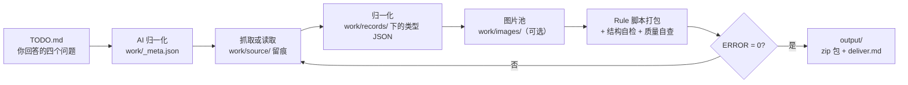

# AI 制作规范

想把某个站点、接口或自己整理的数据做成 AMMDS 能导入的备份包，不用记字段和 zip 结构。做法是：**回答四个问题 → 复制一段提示词交给 AI → 按清单验收**。生成和自检由模板仓库里的规则与零依赖脚本完成，你只管给目标和验收。

字段和格式的权威定义在[备份包规范](./spec.md)；这一页只讲怎么让 AI 把活干了。

## 一、先准备模板仓库

模板仓库把「把数据做成备份包」压缩成**填 4 个空 + 说一句话**：

**https://github.com/QYG2297248353/AMMDS-BackupPackage.git**

克隆或下载后，目录里这几个文件和你有关：

| 文件 | 谁用 | 作用 |
| --- | --- | --- |
| `TODO.md` | 你填 | 回答四个问题，保存即可 |
| `AI.md` | AI 读 | 收到「完成待办事项」后的执行合同 |
| `Rule/AI备份包生成规范.md` | AI 读 | 格式唯一权威，字段表、铁律、自检清单 |
| `tools/auto_backup.py` | AI 跑 | 初始化、预检、打包、自检（只要 Python 3.8+，零第三方库） |
| `docs/示例-TODO.md` | 你参考 | 一份填好的 TODO 样例 |
| `output/` | 交付物 | `*.zip` 备份包 + `deliver.md` 交付说明 |

不想克隆也没关系，用下面「自己带数据」的方式把规范发给 AI 即可；模板仓库能让自检更省事，推荐优先用。

## 二、回答四个问题

打开 `TODO.md`，只有四项要你定：

| 问题 | 你要回答 | 为什么必须问 |
| --- | --- | --- |
| Q1 数据从哪来 | 站点地址 / 接口 / 抓多少、抓哪些 | 目标没法从文件里猜 |
| Q2 做哪种包 | `movie` / `actor` / `comic` / `novel` 四选一 | 决定 `manifest.type` 和整套字段结构 |
| Q3 图片怎么办 | `pack`（打包进包）/ `link`（只写外链）/ `none`（不要图） | 决定包体积和要不要下载图片 |
| Q4 数据谁去拿 | 已有数据文件，还是要 AI 去抓 | 决定走转换还是抓取管线 |

其余的字段映射、目录结构、文件名安全化、`manifest.json`、`imageFiles` 登记、`sha256`、日期格式、枚举 code、匹配键，全部由 AI 按规范处理，**不用你操心**。

选图片策略时记住：漫画 / 相册要**完整迁移必须选 `pack`**；`link` 包体积极小但依赖源站图片长期可访问；`none` 不带图片。

## 三、复制这段提示词交给 AI

把下面整段复制给任意 AI 编码助手，把其中括号里的内容换成你的情况即可：

```text
请按以下规范，把爬取的数据制作为 AMMDS 标准备份包。

一、权威规范（格式细节一律以它为准，不要凭记忆写字段）：
1. 读取模板仓库 https://github.com/QYG2297248353/AMMDS-BackupPackage.git 的
   Rule/AI备份包生成规范.md 与 AI.md；若本地没有，先用 WebFetch 获取原文。
2. 也可对照在线文档 https://ammds.lifebus.top/open-api/backup-restore/spec 核对字段。

二、我的目标（请按我给的实际情况替换）：
- 数据来源：<站点地址 / 接口 / 本地数据文件路径>
- 数据类型：<movie | actor | comic | novel> 四选一
- 图片策略：<pack | link | none>
- 数量范围：<例如 前 100 条 / 某分类全部>

三、执行要求：
1. 先跑 python tools/auto_backup.py todo 预检；不通过就先把错误讲给我听，不要替我猜。
2. 先抓 1 个列表页和 1 个详情页确认真实结构，再写正式抓取脚本；原始响应留痕到 work/source/。
3. 把数据归一化到 work/records/<type>.json，严格遵守规范第十节铁律：
   - movie 每条有 uniqueid 数组和 originalTitle；actor 有 name；comic/novel 有 title。
   - 整数字段写整数（120 而非 120.0）；日期 yyyy-MM-dd；枚举只写 code。
   - movie.poster 是数组、actor.poster 是单值、comic/novel.cover 是单值。
   - 抓不到的字段一律省略，禁止写「未知」「-」占位，更不要编造番号、ISBN、简介、图片。
4. 若是 pack 策略，把图片按 ref 路径放进 work/images/，并确认是真实图片字节而非 403 页面。
5. 跑 python tools/auto_backup.py build 打包并自检；ERROR 不为 0 就修到 0 再交付，
   绝不交付未通过自检的包。
6. 交付时给出：zip 路径、体积、SHA-256、条目数、图片数、自检 ERROR=0，
   以及导入路径和遗留风险清单。

四、不要做的事：
- 不要把 http(s) 外链登记进 imageFiles；不要手写 manifest.json 的 count 或 imageFiles。
- 不要把 Cookie / Token / 账号密码写进任何文件。
- 不要覆盖 Rule/ 下的规则和我的原始数据文件。
```

如果你已经有数据文件、不需要联网抓取，把第三节第 2、4 步去掉，并说明「数据文件在 `<路径>`，请读取后转换」即可。

## 四、AI 会做什么

理解整个流程有助于你验收：



关键点：**`work/source/` 只留痕，`work/records/` 和 `work/images/` 才进包**。删掉 `work/` 和 `output/` 重跑不影响规则（`init` 是幂等的），但不要动 `Rule/`。

## 五、验收清单

拿到 AI 交付的包后，按这几条确认再导入：

- **解析预览通过**：AMMDS → 系统 → 备份恢复 → 数据导入 → 选 zip →「解析预览」显示**校验通过**。
- **冲突策略**：首次导入选 `skip` 或 `overwrite`；`merge` 会保留已有数据并补全空缺。
- **结果 `failed=0`**：导入完成后看失败数，为 0 才算干净。
- **条目数对得上**：交付说明里的条数和导入结果一致；影视按 `uniqueid` 匹配、演员按 `name` 完全匹配，编号写法不一致会被当成新记录。
- **图片可用**：`pack` 包离线可看；`link` 包检查外链现在还能打开。
- **没有占位符**：抽样几条看简介、标题有没有 `"未知"`、`"-"` 之类。

## 六、常见问题

- **AI 问我要不要编几条凑数**：不要。宁可少几条，也不能造假数据——假番号、假 ISBN 导入后就是脏数据。
- **`todo` 预检不通过**：按打印的 ERROR 补齐四个问题；AI 只应就缺的部分问你，最多三个问题。
- **`build` 报图片缺失**：`pack` 策略下有几张图没下载到，要么补下载，要么改成外链（需你同意），要么整包改 `link`。
- **包很大 / 跑很久**：取决于图片量。元数据包几十 KB 到几 MB，整库漫画可能上百 MB 到 GB 级，交付说明会写体积。
- **没有 Python 环境**：模板脚本只要 Python 3.8+ 标准库，不用装第三方包；Windows 也可用 `run.cmd init / todo / build`。
- **想先验证模板框架没坏**：跑 `python tools/auto_backup.py selftest`，用内置数据跑一遍，但它会覆盖 `work/` 和 `output/`，别在交付前跑。
- **导入被拒收**：按[备份包规范 · 校验](./spec.md#八校验什么会被拒收)逐条对，最常见是 `format`、`type` 写错和 `count` 不一致。

## 接着看

- [备份包规范](./spec.md)
- [备份包结构](./overview.md)
- [模板仓库 README](https://github.com/QYG2297248353/AMMDS-BackupPackage)
